# Algorithmique : Notes de TP

> [!question] Préambule
> *Dernière mise à jour : 10/11/2026*
> 
> Ces notes sont destinées à être utilisées dans le cadre du cours d'**Algorithmique** de l'**Université de Namur**, et sont publiées sous la licence **[Creative Commons CC BY-NC-ND 4.0](https://creativecommons.org/licenses/by-nc-nd/4.0/)**, qui signifie que :
> - **BY (Attribution)** : vous pouvez partager ces notes, à condition de créditer leur auteur et de mentionner la licence ;
> - **NC (NonCommercial)** : toute utilisation commerciale est interdite (pas de vente, ni d'intégration dans un produit ou service payant) ;
> - **ND (NoDerivatives)** : pas de version modifiée ou adaptée de ces notes.
> 
> Pour toute question, vous pouvez me contacter à l'adresse suivante : [alix.decrop@unamur.be](mailto:alix.decrop@unamur.be).
> 
> **© 2024-2026 Alix Decrop**

## Chapitre 1 - Algorithmique et Complexité

### Algorithmique

Un **algorithme** est une séquence finie d'instructions rigoureuses permettant de résoudre un problème ou d'accomplir une tâche donnée. En d'autres termes, un algorithme est une méthode systématique qui, en partant de données en entrée, décrit étape par étape les actions à effectuer pour produire des données de sortie.

Il est important en premier lieu d'abstraire un algorithme de tout langage de programmation. En effet, bien qu'on emploie souvent des langages de programmation pour implémenter des algorithmes, ils peuvent également être décrits de diverses autres façons : en langage naturel, avec du pseudocode, etc.

Comme exemple, supposons que l'on voudrait résoudre un problème : **calculer la somme de deux nombres**. Nous pouvons implémenter un algorithme qui va décrire les étapes à effectuer pour résoudre ce problème. Nous pouvons tout d'abord représenter cet algorithme en **langage naturel** (français dans notre cas), un peu comme une recette de cuisine :

```
Étape 1 : lire les valeurs de a et b données en entrée. On suppose que a et b représentent les deux nombres.
Étape 2 : calculer la somme de a et de b.
Étape 3 : afficher la somme obtenue.
Étape 4 : fin des étapes.
```

Ce formalisme est très clair pour un humain, mais ce n'est pas très formel. Nous pouvons rendre cet algorithme plus formel en le représentant avec du **pseudocode** :

```
ALGORITHM: sumTwoNumbers
INPUT: a (integer) and b (integer)
OUTPUT: sum of a and b (integer)

BEGIN
	READ a, b
	SUM = a + b
	PRINT SUM
END
```

L'algorithme est à présent représenté de façon beaucoup plus formelle. Cependant, ce pseudocode mélange du langage naturel et des conventions de nommage logiques/de programmation, ce qui n'est pas lisible par un ordinateur. Pour ce faire, nous pouvons aller encore plus loin et représenter l'algorithme avec le **langage de programmation** Java :

```java
int sumTwoNumbers(int a, int b) {
	int sum = a + b;
	System.out.println("The sum is: " + sum);
	return sum;
}
```

En conclusion, nous avons réalisé un algorithme permettant de résoudre le problème du calcul de la somme de deux nombres. Nous avons implémenté cet algorithme de trois façons différentes : en langage naturel, en pseudocode, et en langage de programmation. Bien que la façon idéale de représenter un algorithme en informatique soit d'utiliser un langage de programmation, il est souvent utile d'abord de représenter un algorithme en langage naturel ou en pseudocode afin d'avoir une idée globale de son fonctionnement.

### Langage Java

> [!tip] Conseil
> Dans le cadre de ce cours, nous allons utiliser le langage de programmation Java pour implémenter des algorithmes. Il est important de noter qu'on ne vous demande pas d'être des professionnels du langage. Ce qui compte surtout, c'est de comprendre les concepts liés aux algorithmes : savoir décomposer un problème, concevoir les étapes, spécifier, organiser les instructions, etc. Une fois que ces notions sont bien assimilées, il devient beaucoup plus facile de passer d'un langage à un autre (car les idées fondamentales restent les mêmes). Maîtriser les concepts liés aux algorithmes est bien plus précieux que de mémoriser la syntaxe de Java !

**Type primitif** : `int` (entier), `boolean` (vrai/faux), `char` (caractère), `float`, `double`, etc.

**Type non-primitif (objet)** : `String` (chaîne de caractères), `int[]` (tableau d'entiers), `String[]` (tableau de chaînes de caractères), etc.

**Opération mathématique** : `+`, `-`, `*`, `/`, `%` (modulo), etc.

**Expression logique** : `&&` (AND), `||` (OR), `!` (négation), etc.

**Commentaire** :

```java
// this is a single line comment

/*
this is
a multiline
comment
*/
```

**Variable** :

```java
int nb = 10;
boolean exists = false;
String[] cars = {"audi", "bmw", "skoda"};
```

**Tableau** :

```java
int[] numbers = {1, 2, 3, 4};
System.out.println(numbers[0]); // prints the first element of numbers (1)
```

**Condition** :

```java
if(a > 0) {
    System.out.println("a is positive");
}
else {
	System.out.println("a is negative or 0");
}
```

**Boucle `for`** :

```java
for(int i = 0; i < 10; i++) {
    System.out.println(i);
}
```

**Boucle `while`** :

```java
while(a > 0) {
    a--;
}
```

**Fonction** :

```java
public static int sum(int x, int y) {
    return x + y;
}
```

**Récursion** :

```java
public static int factorial(int n) {
    if(n == 0 || n == 1) {
        return 1; // base case
    }
    else {
        return n * factorial(n - 1); // recursive call
    }
}
```

L'ensemble de ces concepts en Java devrait déjà constituer une bonne base pour commencer à implémenter des algorithmes.

### Types de Fonctions

Afin d'implémenter un algorithme, on va souvent devoir boucler (itérer plusieurs fois) pour résoudre le problème associé. En effet, beaucoup de problèmes en ont besoin : trouver le minimum dans une liste, trier les éléments d'un tableau, etc. Dans les langages de programmation, on va pouvoir implémenter des fonctions qui bouclent de deux façons différentes :

- **Fonction itérative** : fonction impliquant une boucle (de type `for` ou `while`) répétant des instructions jusqu'à ce qu'une certaine condition soit atteinte.
- **Fonction récursive** : fonction s'appelant elle-même jusqu'à ce qu'une certaine condition soit atteinte. Il faut souvent utiliser plus de paramètres pour transmettre de l'information mise à jour dans les prochaines récursions.

Souvent, l'itération et la récursion sont interchangeables.

### Complexité

Vu que les ressources disponibles d'un ordinateur ne sont (pas encore) illimitées, il est important d'implémenter des algorithmes qui en prennent compte. Donc, lorsqu'on implémente un algorithme, on va mesurer son efficacité sur base de sa consommation en ressources.

La **complexité** algorithmique est une manière de mesurer l'efficacité d'un algorithme. Elle permet de savoir combien de **temps de calcul** ou combien d'**espace mémoire** un algorithme va utiliser en fonction de la taille de son entrée (souvent représentée par $n$). Par exemple, si on a un algorithme qui trie une liste de $n$ entiers, la complexité nous aide à estimer combien d'opérations seront nécessaires quand $n$ devient très grand. La complexité aide notamment à comparer l'efficacité de différents algorithmes, et de choisir le plus adapté à un problème donné.

Selon la ressource, on peut mesurer deux types de complexités :

- **Complexité en temps** : indique combien d'opérations l'algorithme va effectuer.
- **Complexité en espace** : indique combien de mémoire l'algorithme va utiliser.

On utilisera la notation grand $O$ pour représenter la complexité d'un algorithme en fonction des entrées $n$. Par exemple, $O(n)$ représente une complexité linéaire. Afin de comprendre l'impact de la complexité d'un algorithme, on peut visualiser le schéma suivant :

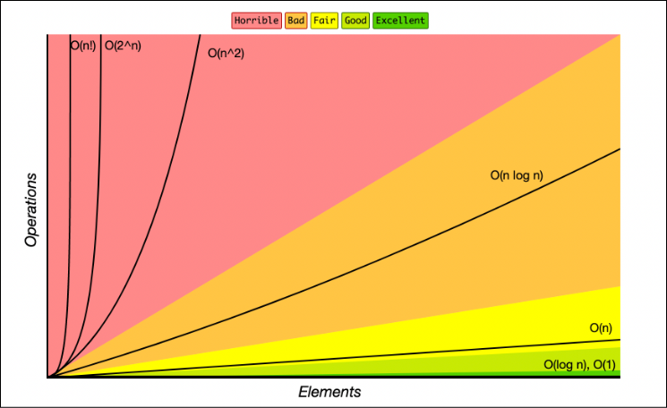

On peut comprendre comment le temps ou l'espace utilisé par un algorithme augmente quand la taille de l'entrée $n$ augmente, et donc en conséquence l'importance d'optimiser les implémentations d'algorithmes.

Lorsqu'on implémente des algorithmes, on retrouve parfois des complexités "types" qui ont leur propre nom :

- $O(1)$ : complexité **constante**.
- $O(log n)$ : complexité **logarithmique**.
- $O(n)$ : complexité **linéaire**.
- $O(n log n)$ : complexité **linéarithmique** ou **loglinéaire**.
- $O(n^2)$ : complexité **quadratique**.
- $O(2^n)$ : complexité **exponentielle**.
- $O(n!)$ : complexité **factorielle**.

Il est possible de calculer la complexité d'un algorithme à partir de son code. L'idée est d'analyser le nombre d'opérations effectuées en fonction de la taille de l'entrée $n$.

**Opérations constantes** : les opérations qui ne dépendent pas de $n$ ont une complexité constante $O(1)$, car peu importe la taille de l'entrée $n$, ces opérations prendront toujours le même temps à exécuter.

```java
public static void test(int n) {
	int a = 2;               // O(1)
	int b = 100000 * 2 / 10; // O(1)
	int c = 10 + n;          // Also O(1) because insignificant
}
```

**Conditions** : lorsqu'une condition `if` pourrait mener vers une complexité très élevée, on la considère car on prend toujours le "pire des cas" pour le calcul de la complexité.

```java
public static void test(int n, int a) {
	if(a > 10) { // O(n^2) ; We consider this as it is the worst case possible
		// Execute n^2 operations
	}
	else { // O(1)
		// Execute 1 operation
	}
}
```

**Boucles** : lorsqu'une boucle itère en fonction de la taille d'entrée $n$, sa complexité correspond également au nombre d'itérations $n$. Il faut faire attention car certaines boucles peuvent itérer plus rapidement et donc avoir une complexité inférieure à $n$. Lorsque des boucles sont imbriquées, on multiplie leurs complexités.

```java
public static void test(int n) {
    // O(n)
    for(int i = 0; i < n; i++) { // we iterate n times
        // code
    }

    // O(n) * O(n) = O(n^2)
    for(int i = 0; i < n; i++) { // we iterate n times
        for(int j = 0; j < n; j++) { // we iterate n times
            // code
        }
    }

    // O(log n)
    for(int i = 1; i < n; i *= 2) { // we iterate log n times
	    // code
    }
}
```

**Récursions** : pour calculer la complexité d'un programme contenant de la récursion, on utilise des **équations récurrentes**.

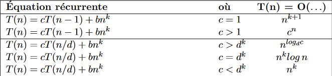

Pour trouver la forme de l'équation, on regarde la forme de la récursion $cT(...)$ et la forme du reste du code $bn^k$. En fonction de l'équation récurrente formée, on peut trouver la complexité finale à l'aide du tableau.

**Simplifications** : il existe des règles à appliquer pour trouver la forme générale d'une complexité.

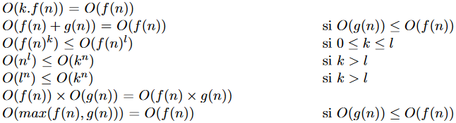

**Formules log** : il existe également des formules pour transformer/simplifier des expressions logarithmiques.

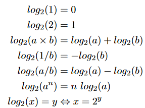

### Mémoïsation

La **mémoïsation** est une technique d'optimisation pour les algorithmes récursifs (qui recalculent souvent les mêmes résultats). L'idée est simple : stocker les résultats déjà calculés dans une structure (tableau, liste, dictionnaire, etc.) pour ne pas devoir les recalculer. Cela permet souvent de réduire la complexité des algorithmes récursifs qui explorent plusieurs fois les mêmes sous-problèmes.

Par exemple, nous pouvons appliquer le principe de mémoïsation à une fonction récursive qui calcule la suite de Fibonacci :

```java
public static int fibonacciMemo(int n, int[] memo) {
	if(n <= 1) {
		return n;  // base case
	}
	
	if(memo[n] != -1) {
		return memo[n];  // case when the result is already in the memo
	}
	
	memo[n] = fibonacciMemo(n - 1, memo) + fibonacciMemo(n - 2, memo);
	
	return memo[n];
}
```

On peut également voir une illustration du principe de mémoïsation pour Fibonacci ci-dessous :

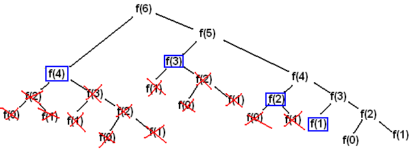

### Exercices

#### Exercice 1.1

Implémentez un algorithme en langage naturel, en pseudocode, et en Java qui permet de trouver le maximum entre deux entiers.

> [!solution]- Solution
> ```java
> public static int max(int a, int b) {
>     if(a > b) {
>         return a;
>     }
>     else {
>         return b;
>     }
> }
> ```

#### Exercice 1.2

Implémentez un algorithme en langage naturel, en pseudocode, et en Java qui permet d'afficher tous les entiers naturels inférieurs à un entier naturel donné.

> [!solution]- Solution
> ```java
> public static void printNumbersBelow(int x) {
>     if(x <= 0) {
>         System.out.println("No numbers to display");
>         return;
>     }
>     for(int i = 0; i < x; i++) {
>         System.out.println(i);
>     }
> }
> ```

#### Exercice 1.3

Implémentez un algorithme en langage naturel, en pseudocode, et en Java qui permet de déterminer si un entier est pair.

> [!solution]- Solution
> ```java
> public static boolean isEven(int x) {
>     return x % 2 == 0;
> }
> ```

#### Exercice 1.4

Implémentez un algorithme en Java dans des fonctions itérative et récursive permettant de renvoyer la valeur minimale d'un tableau d'entiers.

> [!solution]- Solution
> **Version itérative :**
> ```java
> public static int tabMinIterative(int[] tab) {
>     int minValue = tab[0];
>
>     for(int index = 1; index < tab.length; index++) {
>         if(tab[index] < minValue) {
>             minValue = tab[index];
>         }
>     }
>
>     return minValue;
> }
> ```
> **Version récursive :**
> ```java
> public static int tabMinRecursive(int[] tab, int index) {
>     if(index == 0) {
>         return tab[0];
>     }
>
>     int minValue = tabMinRecursive(tab, index - 1);
>
>     if(minValue < tab[index]) {
>         return minValue;
>     }
>     else {
>         return tab[index];
>     }
> }
> ```

#### Exercice 1.5

Implémentez un algorithme en Java dans des fonctions itérative et récursive permettant de calculer la somme des entiers de $1$ à $n$.

> [!solution]- Solution
> **Version itérative :**
> ```java
> public static int sumIterative(int n) {
>     int sum = 0;
>
>     for(int i = 1; i <= n; i++) {
>         sum += i;
>     }
>
>     return sum;
> }
> ```
> **Version récursive :**
> ```java
> public static int sumRecursive(int n) {
>     if (n <= 0) {
>         return 0;
>     }
>
>     return n + sumRecursive(n - 1);
> }
> ```

#### Exercice 1.6

Implémentez un algorithme en Java dans des fonctions itérative et récursive permettant d'inverser une chaîne de caractères.

> [!solution]- Solution
> **Version itérative :**
> ```java
> public static String invertIterative(String str) {
>     StringBuilder reversed = new StringBuilder();
>
>     for(int i = str.length() - 1; i >= 0; i--) {
>         reversed.append(str.charAt(i));
>     }
>
>     return reversed.toString();
> }
> ```
> **Version récursive :**
> ```java
> public static String invertRecursive(String str) {
>     if(str == null || str.length() <= 1) {
>         return str;
>     }
>
>     return invertRecursive(str.substring(1)) + str.charAt(0);
> }
> ```

#### Exercice 1.7

Simplifiez l'ordre de grandeur suivant : $log(n^2) + (log(2^n))^2 + log(4^n) + n * log(n)$.

> [!solution]- Solution
> $2logn + (nlog2)^2 + nlog4 + n * logn$
> $2logn + (n * 1)^2 + (n * 2) + n * logn$
> $2logn + n^2 + 2n + nlogn$
> $logn + n^2 + n + nlogn$
> 
> $O(n^2)$, car $n^2$ est la complexité la plus élevée.

#### Exercice 1.8

Simplifiez, triez, et donnez l'ordre de grandeur ainsi que le nom français des complexités suivantes :

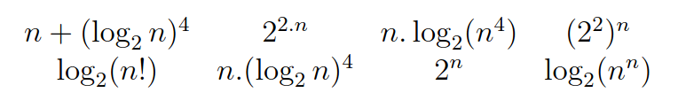

> [!solution]- Solution
> Les ordres de grandeur sont triés du plus rapide au plus lent :
> 
> $n + (log_2 n)^4$ -> $O(n)$ -> Linéaire
> 
> $n * log_2(n^4)$ -> $4nlog(n)$ -> $O(nlogn)$ -> Loglinéaire
> 
> $log_2(n!)$ -> $\approx nlogn$ avec l'approximation de Stirling -> $O(nlogn)$ -> Loglinéaire
> 
> $log_2(n^n)$ -> $O(nlogn)$ -> Loglinéaire
> 
> $n * (log_2(n))^4$ -> $O(n(logn)^4)$ -> Polyloglinéaire (de puissance 4)
> 
> $2^n$ -> $O(2^n)$ -> Exponentielle base 2
> 
> $2^{2n}$ -> $(2^2)^n$ -> $O(4^n)$ -> Exponentielle base 4
> 
> $(2^2)^n$ -> $O(4^n)$ -> Exponentielle base 4

#### Exercice 1.9

Donnez la complexité en temps de la fonction suivante :

```java
public static int funcA(int n) {
    int u = 0;

    for(int i = 0; i <= n * n; i++) {
        u = i;
        while(u > 1) {
            u = u / 2;
        }
    }

    return u;
}
```

> [!solution]- Solution
> ```java
> public static int funcA(int n) {
>     int u = 0; // 1
>
>     for(int i = 0; i <= n * n; i++) { // n^2
>         u = i; // 1
>         while(u > 1) { // log n
>             u = u / 2; // 1
>         }
>     }
>
>     return u; // 1
> }
> ```
>
> On omet les complexités constantes de type $O(1)$, et on multiplie les complexités des boucles imbriquées : $O(n^2) * O(log n)$. On obtient donc la complexité en temps $O(n^2 log n)$ (loglinéaire quadratique).

#### Exercice 1.10

Donnez la complexité en temps de la fonction suivante :

```java
public static int funcB(int n) {
    int r = 0;

    if(n > 4) {
        for(int i = 0; i < 4; i++) {
            r = r + funcB(n/2);
        }
    }

    for(int i = 1; i < n; i *= 2) {
        for(int j = 0; j < n; j++) {
            for(int k = j; k < n; k += 2) {
                r += i + j * k;
            }
        }
    }

    return r;
}
```

> [!solution]- Solution
> ```java
> public static int funcB(int n) {
>     int r = 0; // 1
>
>     if(n > 4) { // Worst case, enter if
>         for(int i = 0; i < 4; i++) { // 4
>             r = r + funcB(n/2); // T(n/2)
>         }
>     }
>
>     for(int i = 1; i < n; i *= 2) { // log n
>         for(int j = 0; j < n; j++) { // n
>             for(int k = j; k < n; k += 2) { // n/2
>                 r += i + j * k; // 1
>             }
>         }
>     }
>
>     return r; // 1
> }
> ```
>
> Forme de la récursion $cT(n/d)$ : $4T(n/2)$.
>
> Forme du reste du code $bn^k$ : $log n * n * n/2 = n^2 log n$ ($n/2$ se transforme en $n$ car on omet la constante $2$).
>
> On obtient l'équation récurrente : $4T(n/2) + n^2 log n$, ce qui correspond à la condition $c = d^k \Leftrightarrow 4 = 2^2$.
>
> Ce qui correspond à la complexité $O(n^2 log n)$.

#### Exercice 1.11

Implémentez une fonction renvoyant le nombre de façons de monter un escalier contenant $n$ marches, en montant soit $1$, soit $2$ marches à la fois. Implémentez une version de la fonction sans mémoïsation et une version avec.

> [!solution]- Solution
> **Sans mémoïsation :**
> ```java
> public static int climbStairs(int n) {
>     if(n <= 1) {
>         return 1;
>     }
>
>     return climbStairs(n - 1) + climbStairs(n - 2);
> }
> ```
>
> **Avec mémoïsation :**
> ```java
> public static int climbStairsMemo(int n, int[] memo) {
>     if(n <= 1) {
>         return 1;
>     }
>
>     if(memo[n] != -1) {
>         return memo[n];
>     }
>
>     memo[n] = climbStairsMemo(n - 1, memo) + climbStairsMemo(n - 2, memo);
>
>     return memo[n];
> }
> ```

## Chapitre 2 - Spécification en JML

### Spécification et Vocabulaire

**Spécification** : document/description détaillée qui explique ce que doit faire un programme. Le but d'une spécification est principalement de définir ce qu'un programme doit accomplir, mais elle permet également d'éviter les mauvaises interprétations du code, d'avoir une idée claire du programme avant de le coder, de servir de référence, etc.

Pour définir les comportements attendus de programmes, on va utiliser les notions suivantes :

- **Précondition** : condition qui doit être vraie avant l'exécution d'un programme pour que celui-ci fonctionne correctement.
- **Postcondition** : condition qui doit être vraie après l'exécution d'un programme, à condition que le code se soit terminé correctement. Elle décrit le résultat attendu ou l'état garanti une fois que le code a été exécuté avec succès.
- **Assertion** : condition qui doit être vraie à un point donné dans l'exécution d'un programme, utilisée pour vérifier la validité d'un état ou d'une logique pendant l'exécution.
- **Invariant** : condition qui doit toujours être vraie pendant toute la durée de vie d'un objet ou tout au long de l'exécution d'un programme, généralement entre les appels de méthodes ou au début et à la fin de chaque méthode.

Nous pouvons également mentionner le **triplet de Hoare**, qui est un concept logique décrivant comment l'exécution d'un programme change l'état de la computation. On représente un triplet de Hoare de la façon suivante :

$$\{P\} S \{Q\}$$

Avec :

- $P$ les préconditions du programme
- $S$ le programme
- $Q$ les postconditions du programme

> [!info]
> Si la précondition $P$ est vraie sur l'état du programme $S$ avant l'exécution de ses instructions, alors la postcondition $Q$ sera vraie pour l'état du programme après son exécution.

### Java Modeling Language (JML)

#### Définition

**JML (Java Modeling Language)** est un langage de spécification formelle utilisé pour annoter des programmes écrits en Java. Il permet de décrire le comportement attendu d'une classe ou d'une méthode à l'aide de préconditions, postconditions, invariants, et d'autres assertions qui peuvent être vérifiées formellement. L'objectif est de permettre aux développeurs de spécifier précisément ce qu'un programme doit faire, ce qui facilite la détection de bugs et la vérification de la conformité du code à ses spécifications.

JML fournit une sémantique formelle et rigoureuse, tout en étant accessible pour les développeurs Java.

#### Syntaxe

Une spécification JML s'écrit dans un commentaire Java (les deux syntaxes de commentaires sont valides), juste avant la partie de code que l'on spécifie. Ces commentaires sont interprétés comme des annotations JML lorsqu'ils contiennent un symbole `@` au début du commentaire. Il ne faut pas oublier de terminer chaque annotation JML par un symbole `;`, comme pour une ligne de code classique en Java.

```java
// @ JML Specification;

/* @ JML Specification; */
```

La syntaxe de base en JML comprend les éléments suivants :

`requires` : définit une précondition pour la fonction.

```java
// Example
// @ requires a != null && a.length > 0;
```

> [!info]
> Par défaut, une valeur ou référence en JML n'est jamais `null` (i.e. vide ou nulle). Ici, `a != null` est mis à titre indicatif mais n'est pas obligatoire. Pour prendre en compte le fait qu'une valeur peut être `null`, on peut utiliser les éléments JML `nullable` ou `non_null`.

`ensures` : définit une postcondition pour la fonction. Cela implique que l'exécution se termine "normalement". Pour gérer les exécutions qui se terminent de façon anormale, on utilise `signals`.

```java
// Example
// @ ensures a >= 0 || b >= 0;
```

`signals` : définit une postcondition pour quand la fonction renvoie une exception. Cela implique que l'exécution se termine de façon anormale ou non-prévue.

`signals_only` : définit quelles exceptions peuvent être renvoyées quand la précondition donnée est vérifiée.

`assignable` : définit quelles variables/quels champs peuvent être modifiés par la fonction. Les variables locales (i.e., déclarées dans la fonction) ne nécessitent pas de clause `assignable` ; cette clause est surtout utilisée pour les variables qui résident hors de la fonction spécifiée (e.g., attributs d'une classe qui sont modifiés dans une fonction mais qui ne sont pas passés en paramètres, variables globales, etc.).

```java
// Example
// @ assignable \nothing;
// Here, nothing is assignable
// OR
// @ assignable x, y;
// Here, x and y will be modified
```

`pure` : déclare qu'une fonction n'a pas d'effets de bord (i.e., ne modifie l'état d'aucun autre objet). Une fonction `pure` a implicitement la clause `assignable \nothing`, mais peut aussi renvoyer des exceptions. Une fonction dite `pure` est toujours censée terminer "normalement" (déterministe, renvoie toujours la même réponse pour un paramètre donné), ou bien renvoyer une erreur.

```java
// Example
// @ pure
int square(int x) {
    return x * x;
}

// Not pure
int counter = 0;
// ...
int addCounter() {
    counter++;
    return counter;
}
```

`invariant` : définit une propriété invariante de la fonction.

```java
// Example
// @ public invariant balance >= 0 && balance <= MAX_BALANCE;
```

`loop_invariant` : définit un invariant pour une boucle, qui doit être vérifié tant que la boucle est exécutée.

`decreases` : utilisé pour démontrer la terminaison de boucle.

```java
// Example
// @ loop_invariant i >= 0 && i < MAX_LENGTH;
// @ decreases tab.length - i;
```

`also` : permet de combiner des cas de spécifications, ou bien de faire hériter une fonction de spécifications (pas utilisé dans le cours).

`assert` : définit une assertion en JML.

```java
// Example
// @ assert amount > 0 : "Deposit amount must be positive";
```

`public` : déclare une annotation JML publique.

```java
// Example
// @ public invariant balance >= 0;
```

`spec_public` : déclare un champ public, uniquement visible par la spécification JML.

```java
// Example
private /*@ spec_public @*/ int balance;
// The private balance field will be visible (public) for the JML specification
// Or
// @ spec_public
private int account;
```

`\result` : identifiant/variable représentant le résultat/la valeur de retour d'une fonction (lorsque la valeur de retour n'a pas de nom).

```java
// Example
// @ ensures (\result >= 0 && \result <= 10);
// Here, we combine ensures and \result to create a JML annotation
```

`\old(<expression>)` : utilisé pour faire référence à l'ancienne valeur de `<expression>`, c'est-à-dire son état avant exécution de la fonction.

```java
// Example
// @ ensures balance == \old(balance) + amount;
// Here, we ensure that the new balance is equal to the old balance, plus the amount
```

`\forall <decl>; <range>; <body>` : permet de représenter une expression mathématique de type "pour tout" ($\forall$).

```java
// Example
// @ ensures \forall int i; 0 <= i < a.length ; a[i] == 0;
// The postcondition here is that all elements of the table a are equal to 0
```

`\exists <decl>; <range>; <body>` : permet de représenter une expression mathématique de type "il existe" ($\exists$).

```java
// Example
// @ requires \exists int j; 0 <= j < a.length; a[j] % 2 == 0;
// The precondition here is that there exists an element with index j in the table a that is even
```

`\typeof(<value>)` : permet de vérifier le type d'une valeur.

```java
// Example
// @ ensures \typeof(x) == int;
// Simplified version, as JML also contains \type (but accepted in this course)
```

`a ==> b` : représente que `a` implique `b`.

`a <== b` : représente que `a` est impliqué par `b`.

`a <==> b` : représente que `a` est vrai si et seulement si `b`.

`==`, `!=`, `&&`, `||`, `!`, `etc.` : JML emploie également la syntaxe logique de Java (et, ou, négation, etc.).

`x > y ? x : y` : JML emploie également les opérateurs ternaires.

`\max`, `\min`, `\sum`, `\product` : JML fournit d'autres expressions de quantification.

```java
// Example
// @ ensures \result == \max int i; 0 <= i < a.length; a[i];
// The postcondition here ensures that the result is equal to the maximum of the table a
```

```java
// Example
// @ ensures \result == \product int i; 0 <= i < a.length; a[i];
// The postcondition here ensures that the result is equal to the product of all elements of the table a
```

On peut noter que, par exemple, le raccourci `\max` est équivalent à l'expression suivante :

```java
// @ ensures \result == \max int i; 0 <= i < tab.length; tab[i];
// Is equivalent to
// @ ensures (\exists int j; 0 <= j < tab.length; \result == tab[j]) && (\forall int i; 0 <= i < tab.length; \result >= tab[i]);
```

`(*...*)`, `JML.informal("...")` : permet de représenter une expression de façon informelle.

```java
// Example
// @ ensures (* data structure is OK *);
// OR 
// @ ensures JML.informal("data structure is OK");
```

> [!danger] Attention
> À éviter autant que possible : `(*...*)` et `JML.informal("...")` ! Ne pas utiliser à l'examen.

### Exercices

#### Exercice 2.1

Spécifiez en JML : tous les entiers entre les index $i$ et $j$ (inclus) d'un tableau $a$ sont égaux à zéro.

> [!solution]- Solution
> ```java
> // @ requires 0 <= i < j < a.length;
> // @ ensures \forall int k; i <= k <= j; a[k] == 0;
> ```

#### Exercice 2.2

Spécifiez en JML : tous les entiers d'un tableau $a$ sont distincts.

> [!solution]- Solution
> ```java
> // @ ensures \forall int x, y; 0 <= x < a.length && 0 <= y < a.length && x != y; a[x] != a[y];
> ```
>
> Une autre solution serait la suivante :
>
> ```java
> /*@ ensures \forall int i, j;
>              0 <= i < a.length &&
>              0 <= j < a.length;
>              i != j ==>
>              a[i] != a[j];
> @*/
> ```

#### Exercice 2.3

Spécifiez en JML : tous les entiers d'un tableau $a$ sont pairs.

> [!solution]- Solution
> ```java
> // @ ensures \forall int x; 0 <= x < a.length; a[x] % 2 == 0;
> ```

#### Exercice 2.4

Spécifiez en JML : tous les entiers d'un tableau $a$ sont inférieurs ou égaux à $2$.

> [!solution]- Solution
> ```java
> // @ ensures \forall int x; 0 <= x < a.length; a[x] <= 2;
> ```

#### Exercice 2.5

Spécifiez en JML : tous les entiers pairs entre les index $i$ et $j$ (inclus) d'un tableau $a$ sont inférieurs à $10$.

> [!solution]- Solution
> ```java
> // @ requires 0 <= i < j < a.length;
> // @ ensures \forall int k; i <= k <= j; (a[k] % 2 == 0) ==> (a[k] < 10);
> ```

#### Exercice 2.6

Spécifiez en JML : il existe un zéro entre les index $i$ et $j$ (inclus) d'un tableau $a$.

> [!solution]- Solution
> ```java
> // @ requires 0 <= i < j < a.length;
> // @ ensures \exists int k; i <= k <= j; a[k] == 0;
> ```

#### Exercice 2.7

Spécifiez en JML : les entiers d'un tableau $a$ sont triés par ordre croissant.

> [!solution]- Solution
> ```java
> // @ ensures \forall int x; 0 <= x < a.length - 1; a[x] <= a[x+1];
> ```

#### Exercice 2.8

Spécifiez en JML : l'entier $x$ est le minimum d'un tableau $a$.

> [!solution]- Solution
> ```java
> // @ requires a.length > 0;
> // @ ensures \exists int p; 0 <= p < a.length; a[p] == x && (\forall int k; 0 <= k < a.length; x <= a[k]);
> ```
>
> Ou plus simplement :
>
> ```java
> // @ requires a.length > 0;
> // @ ensures x == \min int t; 0 <= t < a.length; a[t];
> ```

#### Exercice 2.9

Spécifiez en JML : il existe un et un seul $3$ dans un tableau $a$.

> [!solution]- Solution
> ```java
> // @ ensures \exists int i; 0 <= i < a.length; a[i] == 3 && (\forall int j; 0 <= j < a.length; a[j] == 3 ==> j == i);
> ```
>
> Pour cet exercice, il faut ajouter aux conditions d'un `\exists` classique un `\forall`. L'intuition est que s'il existe un autre index `j` dans le tableau `a` dont la valeur correspondante vaut $3$, alors cet index est le même que `i` (car il n'y a qu'un seul élément du tableau qui vaut $3$).

#### Exercice 2.10

Implémentez la fonction et spécifiez en JML : une fonction `max` qui prend en entrée 2 nombres et qui renvoie le maximum.

```java
int max(int x, int y){}
```

> [!solution]- Solution
> ```java
> // @ pure;
> // @ ensures \result == (x >= y ? x : y); // TERNARY OPERATOR POSTCONDITION
> // OR
> // @ ensures \result == \max int i; i == x || i == y; i; // JML MAX POSTCONDITION
> int max(int x, int y) {
>     if(x > y) return x;
>
>     return y;
> }
> ```

#### Exercice 2.11

Implémentez la fonction et spécifiez en JML : une fonction `contains` qui prend en entrée un tableau de nombres + un nombre et qui renvoie si le nombre fait partie du tableau ou non.

```java
boolean contains(int[] tab, int x){}
```

> [!solution]- Solution
> ```java
> // @ pure;
> // @ requires tab != null; // IMPLICIT IN JML BUT STILL NICE TO INCLUDE
> // @ requires tab.length > 0;
> // @ ensures \result == \exists int i; 0 <= i < tab.length; tab[i] == x;
> boolean contains(int[] tab, int x) {
>     // @ loop_invariant \forall int j; 0 <= j < i; tab[j] != x;
>     // @ assignable \nothing;
>     // @ decreases tab.length - i;
>     for(int i = 0; i < tab.length; i++) {
>         if(tab[i] == x) return true;
>     }
>     return false;
> }
> ```

#### Exercice 2.12

Implémentez la fonction et spécifiez en JML : une fonction `maxTab` qui prend en entrée un tableau de nombres et qui renvoie le maximum.

```java
int maxTab(int[] tab){}
```

> [!solution]- Solution
> ```java
> // @ pure;
> // @ requires tab != null;
> // @ requires tab.length > 0;
> // @ ensures \result == \max int i; 0 <= i < tab.length; tab[i];
> int maxTab(int[] tab) {
>     int max = tab[0];
>     // @ loop_invariant max == \max int j; 0 <= j < i; tab[j];
>     // @ assignable max;
>     // @ decreases tab.length - i;
>     for(int i = 1; i < tab.length; i++) {
>         if(tab[i] > max) max = tab[i];
>     }
>
>     return max;
> }
> ```

#### Exercice 2.13

Implémentez la fonction et spécifiez en JML : une fonction `factorial`, qui prend en entrée un nombre (supérieur ou égal à 0) et qui renvoie sa factorielle.

```java
long factorial(long n){}
```

> [!solution]- Solution
> ```java
> // @ pure;
> // @ requires n >= 0;
> // @ ensures \result == (n <= 1 ? 1 : \product(long i; 1 <= i <= n; i));
> // @ ensures n == 0 ==> \result == 1;
> long factorial(long n) {
>     if(n <= 1) return 1; // base case: avoids the loop (and false invariants) for n = 0 or 1
>
>     long result = 1;
>     // @ loop_invariant (result == \product(long j; 1 <= j < i; j));
>     // @ loop_invariant (2 <= i <= n + 1);
>     // @ loop_invariant (n >= 2);
>     // @ assignable result;
>     // @ decreases n - i + 1;
>     for(long i = 2; i <= n; i++) {
>         result *= i;
>     }
>
>     return result;
> }
> ```
>
> Explications supplémentaires :
>
> - L'invariant de boucle `result == \product(long j; 1 <= j < i; j)` s'assure qu'au début de chaque itération, `result` contient le produit des entiers de `1` jusqu'à `i - 1`. Cet invariant de boucle "traque" la factorielle partielle calculée jusqu'à présent.
> - L'invariant de boucle `2 <= i <= n + 1` s'assure que la variable de boucle `i` va de `2` jusqu'à `n + 1`, ce qui indique un progrès valide dans la boucle.
> - `decreases n - i + 1` s'assure que la boucle va se terminer à un moment donné (mesure à quelle distance `i` est de `n + 1`).

#### Exercice 2.14

Spécifiez en JML : une classe `Counter` qui représente un compteur basique.

```java
public class Counter {

    private int count;

    public Counter() {
        this.count = 0;
    }

    public void inc() {
        this.count++;
    }

    public int getCount() {
        return this.count;
    }
}
```

> [!solution]- Solution
> ```java
> public class Counter {
>
>     /* @ spec_public */ private int count;
>
>     // @ public invariant 0 <= count && count <= Integer.MAX_VALUE;
>
>     // @ ensures count == 0;
>     public Counter() {
>         this.count = 0;
>     }
>
>     // @ requires count < Integer.MAX_VALUE;
>     // @ assignable count;
>     // @ ensures count == \old(count) + 1;
>     public void inc() {
>         this.count++;
>     }
>
>     // @ ensures \result == count;
>     public int getCount() {
>         return this.count;
>     }
> }
> ```

#### Exercice 2.15

Spécifiez en JML : une classe `Banking` qui représente un système simplifié de gestion de compte en banque.

```java
public class Banking {

    public static final int MAX_BALANCE = 1000;
    private int balance;
    private boolean isLocked = false;

    public Banking() {
        this.balance = 0;
    }

    public void credit(final int amount) {
        this.balance += amount;
    }

    public void debit(final int amount) {
        this.balance -= amount;
    }

    public void lockAccount() {
        this.isLocked = true;
    }

    public int getBalance() throws BankingException {
        if(!this.isLocked) {
            return this.balance;
        }
        else {
            throw new BankingException();
        }
    }
}
```

> [!solution]- Solution
> ```java
> public class Banking {
>
>     public static final int MAX_BALANCE = 1000;
>     /* @ spec_public */ private int balance;
>     /* @ spec_public */ private boolean isLocked = false;
>
>     // @ public invariant balance >= 0 && balance <= MAX_BALANCE;
>
>     // @ assignable balance;
>     // @ ensures balance == 0;
>     public Banking() {
>         this.balance = 0;
>     }
>
>     // @ requires (0 < amount && amount + balance <= MAX_BALANCE);
>     // @ assignable balance;
>     // @ ensures (balance == \old(balance) + amount);
>     public void credit(final int amount) {
>         this.balance += amount;
>     }
>
>     // @ requires (0 < amount && amount <= balance);
>     // @ assignable balance;
>     // @ ensures (balance == \old(balance) - amount);
>     public void debit(final int amount) {
>         this.balance -= amount;
>     }
>
>     // @ assignable isLocked;
>     // @ ensures isLocked == true;
>     public void lockAccount() {
>         this.isLocked = true;
>     }
>
>     // @ requires !isLocked;
>     // @ ensures \result == balance;
>     // @ also
>     // @ requires isLocked;
>     // @ signals_only BankingException;
>     public int getBalance() throws BankingException {
>         if(!this.isLocked) {
>             return this.balance;
>         }
>         else {
>             throw new BankingException();
>         }
>     }
> }
> ```

#### Exercice 2.16

Spécifiez en JML : la fonction `sumTab` suivante, renvoyant la somme des nombres d'un tableau donné en entrée.

```java
int sumTab(int[] tab) {
    int sum = 0;

    for(int i = 0; i < tab.length; i++) {
        sum += tab[i];
    }

    return sum;
}
```

> [!solution]- Solution
> ```java
> // @ assignable \nothing;
> // @ requires tab != null;
> // @ ensures \result == \sum(int i; 0 <= i && i < tab.length; tab[i]);
> int sumTab(int[] tab) {
>     int sum = 0;
>     // @ assignable \nothing;
>     // @ loop_invariant (sum == \sum(int j; 0 <= j && j < i; tab[j]));
>     // @ loop_invariant 0 <= i && i <= tab.length;
>     // @ decreases tab.length - i;
>     for(int i = 0; i < tab.length; i++) {
>         sum += tab[i];
>     }
>
>     return sum;
> }
> ```

#### Exercice 2.17

Soit la classe `PetStore` suivante, simulant un magasin d'animaux. La classe contient déjà des spécifications JML ; cependant, certains champs de ces spécifications sont incomplets, invalides, ou manquants. Corrigez ces spécifications JML, en indiquant les détails des erreurs et corrections.

```java
public class PetStore {
	
    private int petsInStock;
    public static final int MAX_PETS = 100;

    // @ requires initialStock >= 0;
    // @ ensures petsInStock == initialStock;
    public PetStore(int initialStock) {
        this.petsInStock = initialStock;
    }

    // @ requires amount > 0;
    // @ ensures petsInStock == \outdated(petsInStock) + amount;
    public void addPets(int amount) {
        petsInStock += amount;
    }

    // @ assignable amount;
    // @ requires amount > 0 && amount <= petsInStock;
    // @ ensures petsInStock == \outdated(petsInStock) - amount;
    public void sellPets(int amount) {
        petsInStock -= amount;
    }

    // @ ensures \result == petsInStock;
    public int getPetsInStock() {
        return petsInStock;
    }
}
```

> [!solution]- Solution
> ```java
> public class PetStore {
>
>     /* AJOUT, sinon la variable n'est pas publique dans la spec JML --> */ /* @ spec_public */ private int petsInStock;
>     public static final int MAX_PETS = 100;
>
>     // INVALIDE, pas de limite supérieure sur le stock --> // @ requires initialStock >= 0;
>     // VALIDE --> // @ requires initialStock >= 0 && initialStock <= MAX_PETS;
>     // @ ensures petsInStock == initialStock;
>     public PetStore(int initialStock) {
>         this.petsInStock = initialStock;
>     }
>
>     // AJOUT, manque une annotation assignable pour petsInStock --> // @ assignable petsInStock;
>     // @ requires amount > 0;
>     // AJOUT, manque une précondition --> // @ requires petsInStock + amount <= MAX_PETS;
>     // INVALIDE, \outdated n'existe pas en JML --> // @ ensures petsInStock == \outdated(petsInStock) + amount;
>     // VALIDE --> // @ ensures petsInStock == \old(petsInStock) + amount;
>     public void addPets(int amount) {
>         petsInStock += amount;
>     }
>
>     // INVALIDE, pas besoin de assignable pour amount car c'est une variable locale; Besoin de assignable pour petsInStock --> // @ assignable amount;
>     // VALIDE --> // @ assignable petsInStock;
>     // @ requires amount > 0 && amount <= petsInStock;
>     // INVALIDE, \outdated n'existe pas en JML --> // @ ensures petsInStock == \outdated(petsInStock) - amount;
>     // VALIDE --> // @ ensures petsInStock == \old(petsInStock) - amount;
>     public void sellPets(int amount) {
>         petsInStock -= amount;
>     }
>
>     // @ ensures \result == petsInStock;
>     // AJOUT, rien d'assignable --> // @ assignable \nothing;
>     public int getPetsInStock() {
>         return petsInStock;
>     }
> }
> ```

## Chapitre 3 - Générer et Tester

> [!quote] Citation
> *"If an army of monkeys were strumming on typewriters they might write all the books in the British Museum."* 
> -- Arthur Eddington

### Principe

**Générer et Tester** est une des méthodes les plus simples en algorithmique pour résoudre un problème donné. La méthode consiste à appliquer la solution la plus directe à un problème, ce qui ne produit pas toujours un temps de calcul optimal. Cependant, cela rend l'implémentation fort aisée. En résumé, on applique l'algorithme de la façon suivante :

1. **Générer :** On génère une solution potentielle au problème.

2. **Tester :** On vérifie que la solution générée satisfait aux critères/contraintes du problème.

3. **Réitérer ou Stopper :** Si la solution générée ne convient pas, on réitère le processus de (1) générer et (2) tester. Sinon, on arrête avec la solution générée.

Attention : si aucune solution n'existe, le processus ne se termine jamais (à moins de limiter le nombre de tentatives). Cela illustre la citation de ce chapitre : avec un nombre infini de tentatives, on finit par trouver la solution, mais pas nécessairement rapidement.

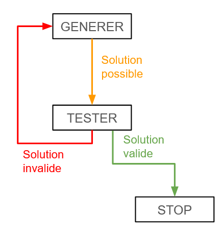

On peut résumer le schéma de la façon suivante :

```java
candidate = generate();
while(!valid(candidate)) {
    candidate = generate();
}
```

> [!tip] Conseil
> Afin d'optimiser la recherche d'une solution valide, il faut **évaluer les contraintes et/ou les objectifs du problème dès que possible**. Cela évite des calculs non nécessaires pour les solutions en aval. Dans certains cas, il est possible de conserver une sous-solution valide, et donc d'éviter de devoir la recalculer (tout en générant une solution globalement valide).

Pour conclure, la méthode Générer et Tester est utile pour des démonstrations ou des problèmes simples où l'espace des solutions est limité. Cependant, elle devient inefficace pour des problèmes complexes et est souvent remplacée par des approches plus avancées/intelligentes qui exploitent les caractéristiques du problème pour réduire le coût computationnel.

### Exemple Introductif

Supposons un problème où l'on voudrait générer un mot valide (en anglais) qui peut être formé à partir d'une liste de lettres. Par exemple, avec la liste `["a", "p", "l", "e"]`, on pourrait former les mots valides `"apple"`, `"pal"`, `"pale"`, etc. En revanche, on pourrait également former les mots invalides `"plapl"`, `"llpa"`, etc.

Donc, pour résoudre ce problème avec la méthode Générer et Tester, on applique les étapes suivantes :

1. Générer un candidat possible (i.e., un assortiment aléatoire de lettres de la liste). Pour augmenter les chances de générer un mot valide en anglais, on peut (1) générer un mot contenant entre $2$ et $n$ lettres, et (2) vérifier si le mot n'a pas encore été généré auparavant.
2. Tester si le candidat généré est valide en le comparant avec un dictionnaire de la langue anglaise.
3. Si le mot n'est pas valide, en régénérer un et retester.

Le processus est aussi simple que cela !

### Avantages et Inconvénients

> [!success] Avantages
> - Facile à comprendre et à implémenter, particulièrement pour des problèmes simples.
> - Peut être appliqué à beaucoup de problèmes différents.
> - Garantit que les solutions fournies sont valides (sur base des contraintes et/ou objectifs de l'énoncé), et optimales si tout l'espace des solutions est comparé (ou via une approche comme **Branch and Bound**).
> - Les critères de test peuvent être facilement modifiés pour s'adapter à différentes contraintes ou objectifs.

> [!failure] Inconvénients
> - Peut être lent et coûteux en ressources (temps et/ou espace) pour des problèmes qui ont un grand espace de solutions, car l'algorithme peut nécessiter une analyse exhaustive de toutes les possibilités.
> - L'approche de base est inefficace car beaucoup de candidats "inutiles" sont potentiellement testés.
> - N'utilise pas les propriétés du problème pour guider la recherche, contrairement au **Branch and Bound**.

### Branch and Bound

**Branch and Bound** est une variante "plus intelligente" de Générer et Tester. La méthode consiste à :

- **Brancher :** Diviser le problème en sous-problèmes plus petits (chaque division formant une "branche" de l'espace des solutions).

- **Borner (Bound) :** Calculer pour chaque sous-problème une borne (limite inférieure ou supérieure) sur la qualité de la meilleure solution qu'il peut contenir.

- **Élaguer :** Éliminer les sous-problèmes dont la borne prouve qu'ils ne peuvent pas conduire à une solution meilleure que celles déjà connues (ou même à une solution valide).

L'objectif de Branch and Bound est donc de réduire l'exploration de l'espace des solutions en se concentrant uniquement sur les branches prometteuses, tout en garantissant que la solution est optimale. C'est une application directe du conseil vu plus haut : évaluer les contraintes le plus tôt possible, avant même de compléter une solution.

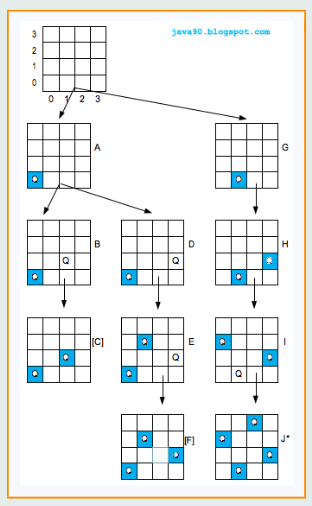

### Exercices

#### Exercice 3.1

**Tri de Tableau :** soit un tableau d'entiers non-triés. Implémentez un algorithme permettant de trier ce tableau, avec la méthode Générer et Tester. Attention, il y a de (très) fortes chances que la complexité ne soit pas du tout optimale !

> [!solution]- Solution
> ```java
> import java.util.Random;
>
> public class SortArrayGT {
> 	
> 	// ITERATE
> 	public static void sortArray(int[] tab) {
> 		Random random = new Random();
> 		while(!isSorted(tab)) {
> 			shuffleArray(tab, random);
> 		}
> 	}
> 	
> 	// TEST
> 	public static boolean isSorted(int[] tab) {
> 		for(int i = 1; i < tab.length; i++) {
> 			if(tab[i - 1] > tab[i]) {
> 				return false;
> 			}
> 		}
> 		return true;
> 	}
> 	
> 	// GENERATE
> 	public static void shuffleArray(int[] tab, Random random) {
> 		for(int i = tab.length - 1; i > 0; i--) {
> 			int index = random.nextInt(i + 1);
> 			int temp = tab[i];
> 			tab[i] = tab[index];
> 			tab[index] = temp;
> 		}
> 	}
> }
> ```
>
> Algorithme également connu sous le nom de **BogoSort**. La complexité est absurde, car on teste toutes les permutations possibles jusqu'à tomber sur la liste triée.
>
> Complexité aléatoire : $O(\infty)$ (non bornée)
>
> Complexité déterministe : $O(n! \times n)$
>
> - $O(n)$ pour vérifier si le tableau est trié
> - $O(n!)$ car il y a, dans le pire des cas, $n!$ permutations possibles (logique combinatoire)

#### Exercice 3.2

**Les Diviseurs :** implémentez un algorithme qui renvoie tous les diviseurs d'un entier $n$ donné en entrée.

> [!solution]- Solution
> ```java
> import java.util.ArrayList;
> import java.util.List;
>
> public static List<Integer> getDivisors(int n) {
> 	List<Integer> divisors = new ArrayList<>();
> 	
> 	for(int i = 1; i <= n; i++) {
> 		if(n % i == 0) {
> 			divisors.add(i);
> 		}
> 	}
> 	
> 	return divisors;
> }
> ```
>
> Pour aller plus loin : les diviseurs vont par paires $(i, n/i)$, donc il suffit de tester les $i$ jusqu'à $\sqrt{n}$ et d'ajouter les deux membres de chaque paire, ce qui réduit la complexité de $O(n)$ à $O(\sqrt{n})$.

#### Exercice 3.3

**Le Potager Aléatoire :** Mr. Dylan Doe aimerait créer un potager aléatoire, sur un jardin (vu de haut, en 2D). Pour ce faire, il place sur chaque case du jardin une zone de potager (40% de chance). Ensuite, il place sur chaque zone de potager une graine de légume : citrouille (50% de chance), aubergine (30% de chance), ou bien carotte (20% de chance). Cependant, quelques contraintes lui sont imposées : (1) une rangée du jardin ne peut pas contenir plus de 50% de zones de potager, (2) il ne peut pas y avoir deux graines de citrouille contiguës sur une même rangée, et (3) il doit y avoir au moins une aubergine ou une carotte sur une même rangée. L'idée est de générer le potager, et de tester les contraintes sur toutes les rangées du jardin. Implémentez un algorithme permettant de générer et de tester le potager. Votre méthode doit renvoyer un tableau à deux dimensions, contenant le potager valide du jardin généré. De plus, lorsque la génération n'est pas valide selon une des contraintes décrites, votre méthode doit afficher la contrainte violée, et tenter de régénérer une solution valide.

> [!solution]- Solution
> ```java
> import java.util.Random;
>
> public class GardenGT {
> 	
> 	public static int[] generateSoil(int[] row, Random rand) {  
> 	    for(int col = 0; col < row.length; col++) {  
> 	        // 40% chance to replace grass with soil (1)  
> 	        row[col] = rand.nextInt(100) < 40 ? 1 : 0;  
> 	    }  
> 	    return row;  
> 	}  
> 	  
> 	public static boolean testSoil(int[] row) {  
> 	    // Constraint: Max 50% of soil on a row  
> 	    int maxSoil = row.length / 2;
> 		  
> 	    for(int col = 0; col < row.length; col++) {  
> 	        if(row[col] == 1) {  
> 	            maxSoil--;  
> 	        }  
> 	        // Constraint: Max 50% of soil on a row  
> 	        if(maxSoil < 0) {  
> 	            System.out.println("Invalid constraint: Row contains more than 50% of soil");  
> 	            return false;  
> 	        }  
> 	    }  
> 	    return true;  
> 	}  
> 	  
> 	public static int[] generateCrops(int[] row, Random rand) {  
> 	    for(int col = 0; col < row.length; col++) {  
> 	        // If the element is not grass (0)  
> 	        if(row[col] != 0) {  
> 	            int random = rand.nextInt(100);  
> 	            // 50% chance for a pumpkin (2)  
> 	            if(random < 50) {  
> 	                row[col] = 2;  
> 	            }  
> 	            // 30% chance for an eggplant (3)  
> 	            else if(random < 80) {  
> 	                row[col] = 3;  
> 	            }  
> 	            // 20% chance for a carrot (4)  
> 	            else {  
> 	                row[col] = 4;  
> 	            }  
> 	        }  
> 	    }  
> 	    return row;  
> 	}  
> 	  
> 	public static boolean testCrops(int[] row) {  
> 	    boolean containsEggplantOrCarrot = false;  
> 	    for(int col = 0; col < row.length; col++) {  
> 	        if(col < row.length - 1) {  
> 	            // Constraint: Two pumpkins cannot be adjacent  
> 	            if(row[col] == 2 && row[col + 1] == 2) {  
> 	                System.out.println("Invalid constraint: Two pumpkins are adjacent");  
> 	                return false;  
> 	            }  
> 	        }  
> 	        // Constraint: At least one eggplant or carrot in a row  
> 	        if(row[col] == 3 || row[col] == 4) {  
> 	            containsEggplantOrCarrot = true;  
> 	        }  
> 	    }  
> 	    if(!containsEggplantOrCarrot) {  
> 	        System.out.println("Invalid constraint: No eggplant or carrot in row");  
> 	        return false;  
> 	    }  
> 	    return true;  
> 	}  
> 	  
> 	public static int[][] generateGarden(int size, Random rand) {  
> 	    int[][] garden = new int[size][size];
> 		  
> 	    for(int row = 0; row < garden.length; row++) {  
> 	        // (1) Generate and Test the soil of the current row  
> 	        boolean validSoil = false;  
> 	        while(!validSoil) {  
> 	            garden[row] = generateSoil(garden[row], rand);  
> 	            validSoil = testSoil(garden[row]);  
> 	        }  
> 	        // (2) Generate and Test the crops of the current row
> 	        // Do while is another way of generating and testing without boolean variable
> 	        do {
> 			    garden[row] = generateCrops(garden[row], rand);
> 	        } while(!testCrops(garden[row])); 
> 	    }  
> 	    return garden;  
> 	}  
> 	  
> 	public static void main(String[] args) {  
> 	    Random rand = new Random();  
> 	    int size = 10;  
> 	    int[][] garden = generateGarden(size, rand);  
> 	}
> }
> ```

#### Exercice 3.4

**Le Code :** Mme Brie Gand aimerait récupérer le précieux contenu d'un coffre-fort. Cependant, le coffre est verrouillé par un code à six chiffres, ce qui donnerait $10^6$ possibilités. Heureusement, Mme Brie Gand dispose de plusieurs contraintes clés sur le code du coffre : (1) les deux premiers chiffres sont pairs, (2) le troisième chiffre vaut 1, (3) le produit des deux avant-derniers chiffres vaut 24, et (4) le dernier chiffre est premier. Implémentez un algorithme qui trouve un code à six chiffres donné en entrée, selon les contraintes définies. Combien de possibilités y a-t-il ?

> [!solution]- Solution
> ```java
> public static void findCode(String code) {
> 	int[] even_numbers = {0, 2, 4, 6, 8};
> 	int one = 1;
> 	int[][] product_numbers = {{3, 8}, {4, 6}, {6, 4}, {8, 3}};
> 	int[] prime_numbers = {2, 3, 5, 7};
> 	
> 	int attempts = 0;
> 	
> 	// 1 and 2 are even
> 	for(int c1 : even_numbers) {
> 		for(int c2 : even_numbers) {
> 			// 3 is one
> 			int c3 = one;
> 			// 4 and 5 are products of 24
> 			for(int[] pair : product_numbers) {
> 				int c4 = pair[0];
> 				int c5 = pair[1];
> 				// 6 is prime number
> 				for(int c6 : prime_numbers) {
> 					attempts++;
> 					// GENERATE
> 					String candidate = String.format("%d%d%d%d%d%d", c1, c2, c3, c4, c5, c6);
> 					
> 					// TEST
> 					if(candidate.equals(code)) {
> 						System.out.println("Found code after " + attempts + " attempts.");
> 						return;
> 					}
> 				}
> 			}
> 		}
> 	}
> 	System.out.println("Did not find code.");
> }
> ```
>
> Nombre de possibilités : $5 \times 5 \times 1 \times 4 \times 4 = 400$
>
> **À noter :** en encodant directement les contraintes dans la génération des candidats, l'espace de recherche passe de $10^6$ possibilités à $400$ candidats, soit un facteur $2500$. C'est exactement le conseil vu dans ce chapitre : évaluer les contraintes le plus tôt possible.

#### Exercice 3.5

**Les Reines de l'Échiquier :** on aimerait trouver toutes les façons possibles de placer $n$ reines sur un échiquier de taille $n \times n$ donné. Comme contrainte, aucune reine placée ne peut en menacer une autre, c'est-à-dire qu'aucune reine ne peut se trouver sur la même rangée, colonne ou diagonale. Implémentez un algorithme renvoyant le nombre de façons de placer les reines, avec l'approche Branch and Bound.

> [!solution]- Solution
> ```java
> import java.util.Arrays;
>
> public class NQueensBranchAndBound {
> 	
> 	private int boardSize; // Size of the board
> 	private int[] board; // board[i] represents the column of the queen placed in row i
> 	private boolean[] column; // Tracks if a column is under attack
> 	private boolean[] diagonal1; // Tracks if a "\" diagonal is under attack
> 	private boolean[] diagonal2; // Tracks if a "/" diagonal is under attack
> 	private int solutionCount = 0; // Counts the number of solutions
> 	
> 	// Constructor
> 	public NQueensBranchAndBound(int boardSize) {
> 		this.boardSize = boardSize;  
> 		this.board = new int[boardSize];  
> 		this.column = new boolean[boardSize];
> 		// Total number of diagonals in a n x n chess board is 2n - 1  
> 		this.diagonal1 = new boolean[2 * boardSize - 1];  
> 		this.diagonal2 = new boolean[2 * boardSize - 1];
> 	}
> 	
> 	// Main solver method
> 	public void solve() {
> 		placeQueen(0); // Start placing queens from row 0
> 		System.out.println("Total solutions found: " + solutionCount);
> 	}
> 	
> 	// Recursive function to place a queen in a given row  
> 	private void placeQueen(int row) {  
> 	    if(row == boardSize) {  
> 		    printSolution(); // Found a valid placement  
> 	        solutionCount++;  
> 	        return;  
> 	    }  
> 		  
> 	    // Try placing the queen in each column  
> 	    for(int col = 0; col < boardSize; col++) {  
> 	        if(isSafe(row, col)) {  
> 	            // Place the queen  
> 	            board[row] = col;  
> 	            mark(row, col, true);
> 				  
> 	            // Recursion to place the next queen  
> 	            placeQueen(row + 1);  
> 				  
> 	            // Backtrack and remove the queen  
> 	            mark(row, col, false);  
> 	        }  
> 	    }  
> 	}
> 	
> 	// Check if it is safe to place a queen on the given row and column
> 	private boolean isSafe(int row, int col) {
> 		return !column[col] && !diagonal1[row - col + boardSize - 1] && !diagonal2[row + col];
> 	}
> 	
> 	// Marks or unmarks the constraints for a queen at (row, col)
> 	private void mark(int row, int col, boolean place) {
> 		column[col] = place;
> 		diagonal1[row - col + boardSize - 1] = place;
> 		diagonal2[row + col] = place;
> 	}
> 	
> 	// Prints the current board configuration
> 	private void printSolution() {
> 		for(int i = 0; i < boardSize; i++) {
> 			char[] row = new char[boardSize];
> 			Arrays.fill(row, '.');
> 			row[board[i]] = 'Q';
> 			System.out.println(new String(row));
> 		}
> 		System.out.println();
> 	}
> 	
> 	// Main method
> 	public static void main(String[] args) {
> 		int boardSize = 8; // Change this value for different board sizes
> 		NQueensBranchAndBound solver = new NQueensBranchAndBound(boardSize);
> 		solver.solve();
> 	}
> }
> ```

## Chapitre 4 - Diviser pour Régner

> [!quote] Citation
> *"Un problème divisé est déjà à moitié résolu."*
> -- Anonyme

### Principe

**Diviser pour Régner (Divide and Conquer)** est une méthode algorithmique consistant à résoudre un problème en le divisant en sous-problèmes plus petits, en résolvant ces sous-problèmes de manière récursive, puis en combinant leurs solutions pour obtenir la solution du problème initial. Le processus de cette méthode algorithmique peut être décomposé en :

1. **Diviser :** Diviser le problème initial en plusieurs sous-problèmes similaires, mais plus simples.
2. **Régner :** Résoudre récursivement chaque sous-problème, jusqu'à atteindre un cas de base. Lorsqu'un sous-problème est suffisamment petit, sa solution peut être calculée directement.
3. **Combiner :** Fusionner (progressivement) les solutions des sous-problèmes, afin de produire une solution du problème original.

> [!info]
> La méthode Diviser pour Régner peut être employée dans divers types de problèmes (tris optimaux, recherche binaire, problème de sélection, etc.) et mène à des algorithmes très efficaces.

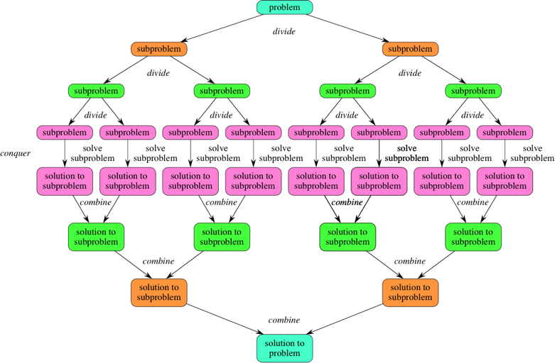

### Avantages et Inconvénients

> [!success] Avantages
> - Les algorithmes qui utilisent Diviser pour Régner ont souvent une meilleure complexité en temps. Parfois, la méthode permet de passer de $O(n)$ à $O(log n)$ vu le mécanisme de division du problème en sous-problèmes.
> - Les sous-problèmes sont souvent indépendants, et donc peuvent être résolus en parallèle.
> - Décomposer un problème difficile en sous-problèmes plus simples peut rendre son implémentation plus facile à comprendre.

> [!failure] Inconvénients
> - Vu que Diviser pour Régner utilise beaucoup de récursion, la pile d'appels de la récursion peut vite devenir profonde et en conséquence consommer plus de mémoire (et donc, une plus mauvaise complexité en espace).
> - Peut être "overkill" pour des problèmes assez simples.
> - L'implémentation du mécanisme complet de Diviser pour Régner peut être difficile.

### Algorithmes de Tri

Un cas d'application de la méthode algorithmique Diviser pour Régner est le tri de tableau. En effet, il existe deux algorithmes bien connus qui utilisent cette méthode pour trier un tableau : le **Merge Sort** et le **Quick Sort**.

#### Merge Sort

Le **Merge Sort** est un algorithme de tri qui emploie la méthode Diviser pour Régner. L'algorithme fonctionne en divisant récursivement un tableau donné en deux parties (jusqu'à obtenir des sous-tableaux de taille 1), puis en triant récursivement ces sous-tableaux, et enfin en les recombinant récursivement pour obtenir le tableau initial trié.

L'image ci-dessous représente un exemple du fonctionnement de l'algorithme Merge Sort sur un tableau.

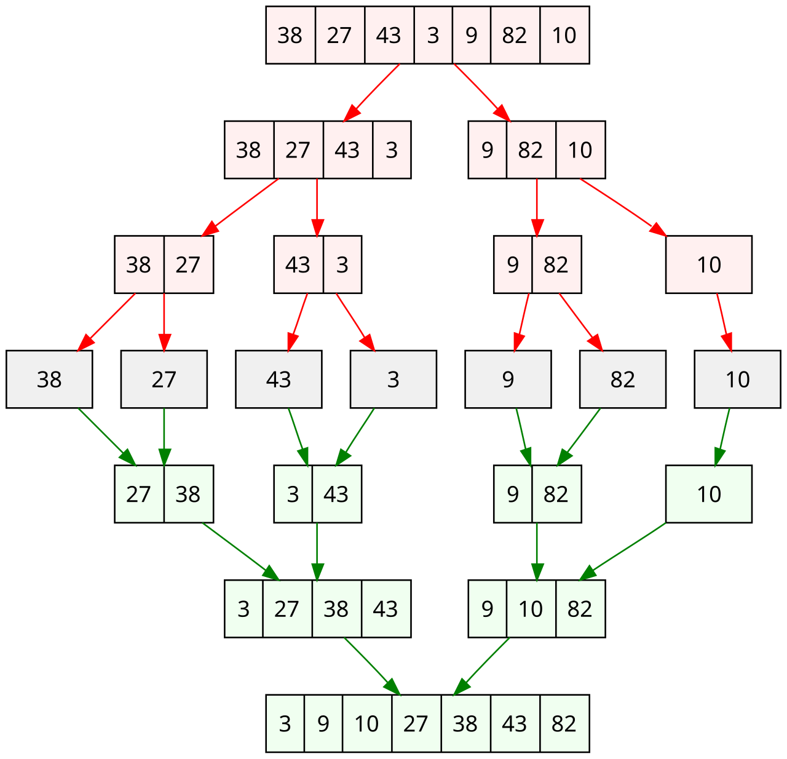

L'aspect "merge" de l'algorithme Merge Sort fonctionne de la façon suivante :

1. Prendre les deux sous-tableaux $L$ et $R$, et initialiser deux pointeurs $i$ et $j$ qui pointent vers le premier élément de chaque tableau respectivement.
2. Initialiser un tableau vide $M$, de taille $|L + R|$, et initialiser un pointeur $k$ à 0.
3. Tant que les pointeurs ne pointent pas chacun vers le dernier élément de leur tableau respectif, comparer $L[i]$ et $R[j]$.
	- Si $L[i] < R[j]$, ajouter $L[i]$ à $M[k]$ et incrémenter $i, k$.
	- Si $R[j] < L[i]$, ajouter $R[j]$ à $M[k]$ et incrémenter $j, k$.
4. Lorsqu'un pointeur d'un tableau n'a plus d'éléments à analyser, il suffit d'ajouter les éléments restants de l'autre tableau dans $M$.
5. Le tableau $M$ contiendra alors les éléments de $L$ et $R$ triés.

> [!info]
> Vu que ce processus est appliqué récursivement, on est certain qu'à chaque étape **les deux tableaux fournis sont eux-mêmes triés**. C'est pour cette raison que le mécanisme de pointeur fonctionne. Autrement dit, puisque les tableaux $L$ et $R$ sont déjà triés, la plus petite valeur correspond nécessairement à la valeur d'un des deux pointeurs. En sélectionnant systématiquement cette valeur minimale et en l'ajoutant au tableau $M$, on obtient naturellement un tableau final qui est trié.

#### Quick Sort

Le **Quick Sort** est un autre algorithme de tri qui emploie également la méthode Diviser pour Régner. L'algorithme fonctionne en sélectionnant un élément "pivot" dans un tableau donné et en partitionnant les autres éléments en deux sous-tableaux, en fonction de s'ils sont inférieurs ou supérieurs au pivot choisi.

L'image ci-dessous représente un exemple du fonctionnement de l'algorithme Quick Sort sur un tableau.

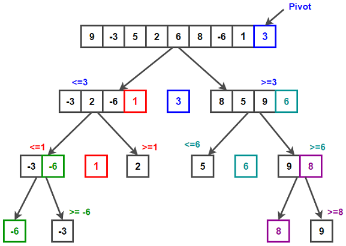

L'aspect "pivot" de l'algorithme Quick Sort fonctionne de la façon suivante :

1. Choisir une valeur du tableau comme pivot. On utilise souvent le dernier élément du tableau comme pivot.
2. On partitionne le tableau selon le pivot choisi, en itérant sur chaque valeur :
	- Si la valeur est plus petite que le pivot, on la déplace à gauche du pivot.
	- Si la valeur est plus grande ou égale au pivot, on la déplace à droite du pivot.
	- On utilise souvent deux pointeurs pour réaliser ce processus, qui itèrent sur le tableau et échangent les positions des valeurs quand c'est nécessaire.
3. On applique ce processus récursivement pour les deux sous-tableaux générés (les valeurs à gauche et à droite du pivot), en choisissant de nouveau un pivot pour chaque tableau.
4. Lorsqu'on obtient des tableaux de taille 0 ou 1, notre tableau initial est trié grâce au mécanisme de pivot et de permutation de valeurs.

> [!info]
> L'algorithme Quick Sort fonctionne car après une étape de partitionnement, le pivot se retrouve dans sa position correcte vu que les valeurs à sa gauche sont plus petites et les valeurs à sa droite plus grandes. Donc, à chaque étape, on se retrouve avec une valeur triée correctement, ce qui produit au final un tableau naturellement trié.

### Exercices

#### Exercice 4.1

Implémentez en Java l'algorithme Merge Sort. Quelle est sa complexité en temps et en espace ?

> [!solution]- Solution
> ```java
> public class MergeSort {
>
>     // Method which merges and sorts a given left and right array
>     static int[] merge(int[] leftArray, int[] rightArray, int[] array) {
>
>         int li = 0, ri = 0, si = 0;
>
>         // While there are still elements in both arrays
>         while(li < leftArray.length && ri < rightArray.length) {
>             if(leftArray[li] < rightArray[ri]) {
>                 // x++ utilizes the index x and then increments it by 1
>                 // or, the shorthand array[si++] = leftArray[li++];
>                 array[si] = leftArray[li];
>                 si++;
>                 li++;
>             }
>             else {
>                 array[si] = rightArray[ri];
>                 si++;
>                 ri++;
>             }
>         }
>
>         // As left and right arrays are recursively sorted, we are sure that all elements are already sorted in each
>
>         // While there are still elements in the left array
>         while(li < leftArray.length){
>             array[si] = leftArray[li];
>             si++;
>             li++;
>         }
>
>         // While there are still elements in the right array
>         while(ri < rightArray.length){
>             array[si] = rightArray[ri];
>             si++;
>             ri++;
>         }
>
>         return array;
>     }
>
>     // Method which applies the merge sort algorithm to a given array
>     static int[] mergeSort(int[] array) {
>
>         int arrayLength = array.length;
>
>         // If the array contains 0 or 1 element, it is already sorted
>         if(arrayLength < 2) {
>             return array;
>         }
>
>         // Split the array in half
>         int mid = arrayLength / 2;
>         int[] leftArray = new int[mid];
>         int[] rightArray = new int[arrayLength - mid];
>
>         // Create the sub-arrays
>         System.arraycopy(array, 0, leftArray, 0, mid);
>         System.arraycopy(array, mid, rightArray, 0, arrayLength - mid);
>
>         // Recursive call to split again
>         mergeSort(leftArray);
>         mergeSort(rightArray);
>
>         return merge(leftArray, rightArray, array);
>     }
>
>     // Method for main code
>     public static void main(String[] args) {
>
>         // Array example
>         int[] inputArray = {10, 4, 6, 3, 7, 9, 20, 1};
>
>         // Algorithm execution
>         int[] sortedArray = mergeSort(inputArray);
> 	}
> }
> ```
>
> **Complexité en temps :** Séparer un tableau en deux se fait en $O(1)$. Appliquer le merge se fait en $O(n)$, car on itère tant qu'il y a des valeurs dans les tableaux. Pour la profondeur de la récursion, on sépare à chaque fois le tableau en deux donc la profondeur est de $O(log n)$. Donc, en combinant ces complexités, on obtient une complexité en temps de $O(n log n)$.
>
> **Complexité en espace :** Vu que l'algorithme Merge Sort divise le tableau initial en sous-tableaux récursivement jusqu'à ce que l'on obtienne des tableaux de taille 1, à chaque niveau de récursion les sous-tableaux créés contiennent au total $n$ éléments (il y a $O(log n)$ niveaux). Donc, l'espace supplémentaire total est de $O(n)$.
>
> Il existe des variantes qui diminuent la complexité en espace de l'algorithme Merge Sort, en utilisant des "linked lists". Cependant, nous n'aborderons pas cela dans le cours et utiliserons l'approche "classique".

#### Exercice 4.2

Implémentez en Java l'algorithme Quick Sort. Quelle est sa complexité en temps et en espace ?

> [!solution]- Solution
> ```java
> public class QuickSort {
>
>     // Method which selects a pivot and sorts elements in the array accordingly
>     static int partition(int[] array, int begin, int end) {
>
>         int pivot = array[end]; // Here, the pivot is the last array element
>         int i = begin - 1;
>
>         for(int j = begin; j < end; j++) {
>             if(array[j] <= pivot) {
>                 i++;
>
>                 // Swap elements
>                 int temp = array[i];
>                 array[i] = array[j];
>                 array[j] = temp;
>             }
>         }
>
>         int temp = array[i+1];
>         array[i+1] = array[end];
>         array[end] = temp;
>
>         // Return the partitioning index
>         return i + 1;
>     }
>
>     // Method which applies the quick sort algorithm to a given array
>     static void quickSort(int[] array, int begin, int end) {
>
>         if(begin < end) {
>
>             // Get partition index
>             int partitionIndex = partition(array, begin, end);
>             
>             // Divide into 2 sections and sort recursively
>             quickSort(array, begin, partitionIndex - 1);
>             quickSort(array, partitionIndex + 1, end);
>         }
>     }
>
>     // Method for main code
>     public static void main(String[] args) {
>
>         // Array example
>         int[] inputArray = {10, 4, 6, 3, 7, 9, 20, 1};
>
>         // Algorithm execution
>         quickSort(inputArray, 0, inputArray.length - 1);
>     }
> }
> ```
>
> **Complexité en temps :** À chaque partitionnement, l'algorithme itère sur tous les éléments du tableau pour pouvoir placer le pivot correctement et effectuer les permutations, ce qui se fait en $O(n)$. Cependant, il se peut que le pivot soit toujours proche de la plus grande/petite valeur de la liste, ce qui déséquilibre les éléments plus petits et plus grands que le pivot et en conséquence nécessite davantage de partitionnements. Donc, il y a deux cas possibles :
> - Si le pivot sépare (souvent) le tableau en deux parties assez égales, la profondeur moyenne est de $O(log n)$.
> - Par contre, si le pivot est toujours la plus petite/grande valeur du tableau, la profondeur est de $O(n)$.
>
> Donc, dans le meilleur cas et en moyenne la complexité en temps de l'algorithme Quick Sort est de $O(n log n)$, tandis que dans le pire des cas elle est de $O(n^2)$.
>
> **Complexité en espace :** Vu que l'algorithme Quick Sort ne génère pas de tableaux supplémentaires (contrairement au Merge Sort), sa complexité en espace dépend uniquement de la pile d'appels. En moyenne, elle est donc de $O(log n)$, mais dans le pire des cas elle est de $O(n)$.
>
> Cependant, la complexité dans le pire des cas est assez rare et survient quand un tableau est déjà trié ou bien trié à l'envers (si la sélection du pivot n'est pas adéquate). On suppose donc généralement que le Quick Sort a une complexité en temps de $O(n log n)$ et une complexité en espace de $O(log n)$.

#### Exercice 4.3

**Recherche Binaire :** implémentez en Java un algorithme renvoyant l'index correspondant à une valeur donnée en entrée, dans un tableau trié par ordre croissant. La complexité en temps de votre algorithme ne peut pas dépasser $O(log n)$.

> [!solution]- Solution
> ```java
> public class BinarySearch {
>
>     // Method for algorithm
>     static int binarySearch(int[] sortedArray, int target, int left, int right) {
>
>         if(left <= right) {
>             int mid = left + (right - left) / 2;
>
>             if(sortedArray[mid] == target) return mid;
>
>             else if(sortedArray[mid] < target) return binarySearch(sortedArray, target, mid + 1, right);
>
>             else return binarySearch(sortedArray, target, left, mid - 1);
>         }
>
>         // Return -1 if no index corresponding to value found
>         return -1;
>     }
>
>     // Method for main code
>     public static void main(String[] args) {
>
>         int[] sortedArray = {1, 2, 3, 4, 5, 6, 7, 8, 9};
>         int target = 1;
>
>         int result = binarySearch(sortedArray, target, 0, sortedArray.length - 1);
>
>         if(result != -1) System.out.println("Found value " + target + " at index: " + result);
>
>         else System.out.println("Did not find value");
>     }
> }
> ```
>
> **Complexité en temps :** À chaque appel récursif, on ne garde que la moitié du tableau, et le reste du code est constant. On obtient donc l'équation récurrente $T(n/2) + O(1)$, ce qui correspond à la complexité $O(log n)$ via le tableau des équations récurrentes du Chapitre 1 (cas $c = d^k \Leftrightarrow 1 = 2^0$).

#### Exercice 4.4

**La Puissance :** implémentez en Java un algorithme renvoyant le résultat de $x^y$, $x$ et $y$ étant donnés en entrée. La complexité en temps de votre algorithme ne peut pas dépasser $O(log n)$.

> [!tip] Indice
> $x^y = 1$ si $y = 0$
> $x^y = (x^{\lfloor y/2 \rfloor})^2$ si $y > 0$ et $y$ pair
> $x^y = x \times (x^{\lfloor y/2 \rfloor})^2$ si $y > 0$ et $y$ impair

> [!solution]- Solution
> ```java
> public class Power {
>
>     // Method for algorithm
>     static int power(int x, int y) {
>
>         // Base case
>         if(y == 0) return 1;
>
>         int temp = power(x, y/2);
>
>         if(y % 2 == 0) return temp * temp;
>
>         else return x * temp * temp;
>     }
>
>     // Method for main code
>     public static void main(String[] args) {
>
>         int x = 3;
>         int y = 14;
>
>         int pow = power(x, y);
>
>         System.out.println(pow);
>     }
> }
> ```
>
> **Complexité en temps :** À chaque appel récursif, la valeur de $y$ est divisée par $2$, et le reste du code est constant. La profondeur de la récursion est donc de $O(log y)$, ce qui donne une complexité en temps de $O(log y)$ (sur base de la même logique que la recherche binaire de l'exercice précédent). À noter que l'algorithme suppose que $y \geq 0$ ; pour $y < 0$, il faudrait d'abord traiter le cas en renvoyant $1/x^{|y|}$.

#### Exercice 4.5

**Tours de Hanoï :** implémentez en Java un algorithme permettant de résoudre le problème des tours de Hanoï. Votre algorithme doit afficher les étapes pour résoudre le problème ainsi que le nombre total de déplacements à effectuer.

> [!solution]- Solution
> ```java
> public class TowersOfHanoi {
>
> 	static void towersOfHanoi(int n, char source, char between, char dest) {
> 		
> 		// Base case: Only one disk to move
> 		if(n == 1) {
> 			System.out.println("Move disk 1 from " + source + " to " + dest);
> 			return;
> 		}
> 		
> 		// Move n-1 disks from source to between
> 		towersOfHanoi(n - 1, source, dest, between);
> 		
> 		// Move nth disk from source to dest
> 		System.out.println("Move disk " + n + " from " + source + " to " + dest);
> 		
> 		// Move n-1 disk from between to dest
> 		towersOfHanoi(n - 1, between, source, dest);
> 	}
>
> 	public static void main(String[] args) {
> 	
> 		int nbDisks = 3;
> 		
> 		char pillarSource = 'A';
> 		char pillarBetween = 'B';
> 		char pillarDest = 'C';
> 		
> 		towersOfHanoi(nbDisks, pillarSource, pillarBetween, pillarDest);
> 		
> 		// The min nb of moves is 2^n - 1
> 		double minMoves = Math.pow(2, nbDisks) - 1; // double as Math.pow returns a double
> 		System.out.println("Min nb of moves: " + minMoves);
> 	}
> }
> ```

## Chapitre 5 - Algorithmes Gloutons

### Principe

Un **algorithme glouton** est un algorithme qui consiste à réaliser le choix local optimal à chaque étape de la résolution du problème. Pour de nombreux problèmes, un algorithme glouton ne produit pas une solution optimale, vu la façon dont il fonctionne, mais permet de trouver une solution en un temps de calcul très raisonnable. Le processus d'un algorithme glouton peut être décomposé en :

1. **Choix localement optimal :** À chaque étape, faire le choix qui semble être le meilleur sur le moment, sans regarder plus loin dans le problème.
2. **Garantir une solution globale et optimale :** Pour garantir que la solution globale est optimale, il faut prouver 2 propriétés :
	- **Globalement optimal :** Le choix localement optimal fait partie d'une solution globalement optimale.
	- **Sous-structure optimale :** Démontrer qu'après avoir fait le choix glouton, on se retrouve avec un sous-problème tel que, si l'on combine une solution optimale du sous-problème et le choix glouton que l'on a fait, on arrive à une solution optimale du problème initial.

### Avantages et Inconvénients

> [!success] Avantages
> - La complexité en temps d'un algorithme glouton est souvent raisonnable, vu que l'algorithme se focalise uniquement sur un choix localement optimal à chaque étape de la résolution du problème.
> - L'implémentation d'un algorithme glouton peut être plus simple, vu qu'il faut trouver une solution locale au problème, et non une solution générale directement.

> [!failure] Inconvénients
> - Vu qu'un algorithme glouton fonctionne en trouvant des solutions locales, il se peut que certaines résolutions ne soient pas globalement optimales (e.g., le chemin le plus court dans des nœuds de graphe).
> - Une fois qu'un algorithme glouton prend une décision, il ne peut pas revenir en arrière. Il est donc important de bien définir les choix locaux. Par exemple, dans certains problèmes de chemins optimaux dans un graphe, un choix initial peut empêcher d'explorer un chemin meilleur qui devient accessible plus tard.

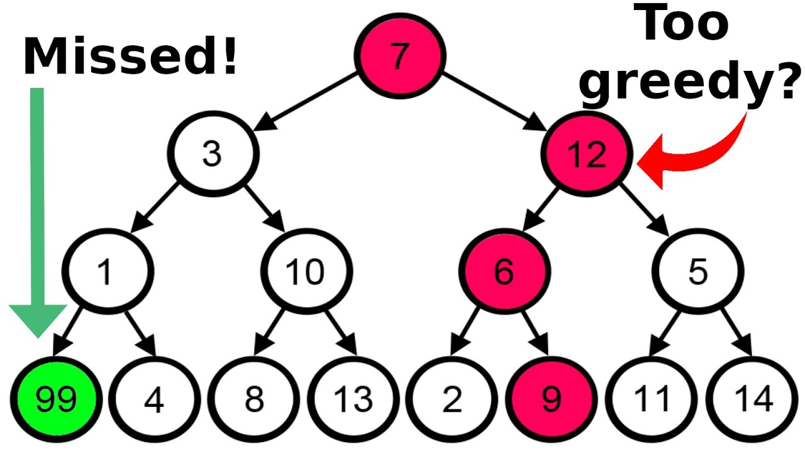

### Exercices

#### Exercice 5.1

**Monnaie Minimale :** implémentez en Java un algorithme renvoyant le nombre minimal de pièces de monnaie à rembourser pour un montant (entier) donné en entrée. On dispose de pièces de 20, 10, 5, 2, et 1 unité. Par exemple, si le montant spécifié en entrée est de 36, le nombre minimal de pièces à rendre est 4 (1 pièce de 20, 1 pièce de 10, 1 pièce de 5, et 1 pièce de 1).

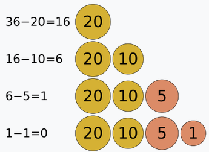

> [!solution]- Solution
> ```java
> int findMinCoins(int value) {
>
> 	if(value < 0) {
> 		return -1;
> 	}
>
> 	int minCoins = 0;
>
> 	// The currencies are sorted in descending order
> 	int[] currencies = {20, 10, 5, 2, 1};
>
> 	// Iterate over each currency, and while we can give current currency, continue doing so
> 	for(int i = 0; i < currencies.length; i++) {
> 		while(value - currencies[i] >= 0) {
> 			minCoins++;
> 			value = value - currencies[i];
> 		}
> 	}
>
> 	return minCoins;
> }
> ```

#### Exercice 5.2

Spécifiez l'algorithme précédent en JML.

> [!solution]- Solution
> ```java
> // @ pure
> // @ requires value >= 0;
> // @ ensures \result >= 0;
> // @ ensures \exists c20, c10, c5, c2, c1 ; c20 >= 0 && c10 >= 0 && c5 >= 0 && c2 >= 0 && c1 >= 0 ; 20 * c20 + 10 * c10 + 5 * c5 + 2 * c2 + 1 * c1 == value && c20 + c10 + c5 + c2 + c1 == \result;
> // Or
> // @ ensures \result == value / 20
> //				      + (value % 20) / 10
> //				      + (value % 20 % 10) / 5
> //                    + (value % 20 % 10 % 5) / 2
> //                    + (value % 20 % 10 % 5 % 2)
> int findMinCoins(int value) {
>
> 	if(value < 0) {
> 		return -1;
> 	}
>
> 	int minCoins = 0;
>
> 	int[] currencies = {20, 10, 5, 2, 1};
>
> 	// @ loop_invariant 0 <= i && i <= currencies.length;
> 	// @ loop_invariant minCoins >= 0;
> 	// @ loop_invariant value >= 0;
> 	// @ decreases currencies.length - i;
> 	// @ loop_assignable minCoins, value;
> 	for(int i = 0; i < currencies.length; i++) {
> 		// @ loop_invariant minCoins >= 0;
> 		// @ loop_invariant value >= 0;
> 		// @ decreases value;
> 		// @ loop_assignable minCoins, value;
> 		while(value - currencies[i] >= 0) {
> 			minCoins++;
> 			value = value - currencies[i];
> 		}
> 	}
>
> 	return minCoins;
> }
> ```

#### Exercice 5.3

**Le Plus d'Activités Possible :** à cause de votre train, vous êtes en retard sur votre séjour d'activités. Initialement, vous aviez prévu de réaliser un ensemble d'activités sur 2 journées, mais vous vous retrouvez avec une seule journée pour les faire... Vous ne baissez pas les bras et décidez tout de même de réaliser le plus d'activités possible. Sur base de $n$ activités, triées par heure de fin $t_e$ croissante, ayant chacune une heure de départ $t_s$ et une heure de fin $t_e$ (représenté par un tableau à 2 dimensions), implémentez un algorithme renvoyant le maximum d'activités à effectuer, n'ayant pas de conflits horaires entre elles.

> [!solution]- Solution
> ```java
> void maxActivities(int[][] activities) {
> 	int nbActivities = activities.length;
> 	
> 	System.out.println("Selected the following activities (by index): ");
> 	
> 	// Always start with the first activity
> 	int i = 0;
> 	System.out.print("Activity " + i);
> 	
> 	for(int j = 1; j < nbActivities; j++) {
> 		// If start of next activity does not overlap with the end of the current activity
> 		if(activities[j][0] >= activities[i][1]) {
> 			System.out.print(", Activity " + j);
> 			i = j;
> 		}
> 	}
> }
> ```

#### Exercice 5.4

**Les Délicieux Gâteaux :** on vous propose un ensemble de gâteaux, représentés par un goût (de 1 à 10) et un poids. Le goût d'un gâteau est proportionnel à son poids ; donc, si un gâteau a un goût de 10 et un poids de 2, sa vraie valeur/poids sera de 5. Vous pouvez emporter des gâteaux dans votre sac, sans qu'ils ne dépassent sa capacité maximale. Il est même possible d'emporter une fraction d'un gâteau ! Vous avez très faim, donc implémentez un algorithme renvoyant la valeur maximale des gâteaux que vous pouvez emporter avec vous, selon leur poids et leur goût.

Vous pouvez vous baser sur la signature de fonction suivante :

```java
/*
Computes the maximum "taste value" of cakes that can be put in the bag without exceeding its capacity.

@param cakes a 2d array where each element represents a cake as [value, weight]
@param capacity the maximum total weight that can be put in the bag
@return the maximum "taste value" of cakes based on the cakes array and the maximum capacity of the bag
*/
int maxCakeTaste(int[][] cakes, int capacity) {}
```

> [!solution]- Solution
> ```java
> /*
> Computes the maximum "taste value" of cakes that can be put in the bag without exceeding its capacity.
>
> @param cakes a 2d array where each element represents a cake as [value, weight]
> @param capacity the maximum total weight that can be put in the bag
> @return the maximum "taste value" of cakes based on the cakes array and the maximum capacity of the bag
> */
> float maxCakeTaste(int[][] cakes, int capacity) {
>
> 	int n = cakes.length;
> 	float[] valuesPerWeight = new float[n];
> 	
> 	for(int i = 0; i < n; i++) {
> 		valuesPerWeight[i] = (float) cakes[i][0] / cakes[i][1];
> 	}
> 	
> 	cakes = sortDescending(cakes, valuesPerWeight); // Call of a sorting function (merge sort, quick sort, etc.)
> 	
> 	float maxTaste = 0;
> 	int remainingCapacity = capacity;
> 	System.out.println("Calculation for a bag weight of " + capacity + ": ");
> 	
> 	// Greedy search
> 	for(int i = 0; i < n; i++) {
> 		// If capacity for full cake, take all
> 		if(remainingCapacity >= cakes[i][1]) {
> 			remainingCapacity -= cakes[i][1];
> 			maxTaste += cakes[i][0];
> 		}
> 		// Else, take fraction of last cake then break
> 		else {
> 			maxTaste += ((float) cakes[i][0] / cakes[i][1]) * remainingCapacity;
> 			break;
> 		}
> 	}
> 	
> 	System.out.println("Maximum possible cake taste: " + maxTaste);
> 	
> 	return maxTaste;
> }
> ```

#### Exercice 5.5

**Fractions Égyptiennes :** il est possible de représenter toute fraction sous forme de *fraction égyptienne*. Une telle fraction consiste en une somme de différentes *fractions unitaires*, c'est-à-dire de la forme $1/n$, avec $n > 0$. Par exemple, la fraction $\frac{5}{8}$ est représentée en fraction égyptienne par $\frac{1}{2} + \frac{1}{8}$. Cette représentation est utile ; si l'on a par exemple 5 tartes qu'il faut répartir entre 8 personnes, la fraction égyptienne correspondante nous dit que chaque personne aura une demi-tarte, plus un huitième de tarte. Implémentez un algorithme permettant de transformer une fraction avec un numérateur et un dénominateur donnés en entrée en sa fraction égyptienne correspondante.

Vous pouvez vous baser sur la signature de fonction suivante :

```java
/*
Finds and displays the egyptian fraction (sum of distinct unit fractions) associated with a given fraction.

@param top the numerator of the fraction
@param bottom the denominator of the fraction
*/
void findEgyptianFraction(int top, int bottom) {}
```

> [!solution]- Solution
> ```java
> void findEgyptianFraction(int top, int bottom) {
>
> 	// Early return: The given numerator and denominator are invalid
> 	if(top <= 0 || bottom <= 0 || top >= bottom) {
> 		System.out.println("The provided fraction numerator and/or denominator are invalid. Make sure that the numerator is smaller than the denominator, and that they are both > 0.");
> 		return;
> 	}
> 	
> 	// Base case: The fraction can be simplified into a unit fraction (e.g., 2/4 becomes 1/2)
> 	if(bottom % top == 0) {
> 		System.out.print("1/" + bottom / top);
> 		return;
> 	}
> 		
> 	// Other case
> 	int n = (bottom / top) + 1;
> 	
> 	System.out.print("1/" + n + " + ");
> 	
> 	findEgyptianFraction(top * n - bottom, bottom * n);
> }
> ```

#### Exercice 5.6

**Choo Choo :** votre chef de projet aimerait construire une nouvelle gare, pour des trains. Cependant, il est très avare (greedy) et aimerait que la station comprenne un minimum de quais afin de minimiser les coûts de construction. Il vous demande donc de déterminer le nombre minimal de quais à construire tout en ne limitant pas la circulation des trains. Attention, car un train en quai alors qu'un autre arrive pourrait être dangereux... Pour ce faire, vous avez à votre disposition l'heure d'arrivée et de départ de chaque train. Avec un algorithme prenant en entrée une liste triée des heures d'arrivée et une liste triée des heures de départ des trains, vous êtes persuadés de pouvoir trouver la solution gloutonne au problème !

Vous pouvez vous baser sur la signature de fonction suivante :

```java
/*
Computes the minimal amount of platforms to build based on train arrivals and departures.
The elements in the arrivals and departures arrays are 4-digit integers representing time in 24h HHMM format such as 1200 (12h00), 1542 (15h42), 0922 (09h22), etc.

@param arrivals an array of train arrivals
@param departures an array of train departures
@return the minimal amount of platforms to build
*/
int findMinPlatforms(int[] arrivals, int[] departures) {}
```

> [!solution]- Solution
> ```java
> /*
> Computes the minimal amount of platforms to build based on train arrivals and departures.
> The elements in the arrivals and departures arrays are 4-digit integers representing time in 24h HHMM format such as 1200 (12h00), 1542 (15h42), 0922 (09h22), etc.
>
> @param arrivals an array of train arrivals
> @param departures an array of train departures
> @return the minimal amount of platforms to build
> */
> int findMinPlatforms(int[] arrivals, int[] departures) {
>
> 	int minPlatforms = 0;
> 	int trainCount = 0;
> 	// Current arrival and departure indexes
> 	int ai = 0, di = 0;
> 	
> 	// While trains still need to arrive
> 	while(ai < arrivals.length) {
> 		// If current arrival time is less than current departure time, update min platforms and increase arrival index by 1
> 		if(arrivals[ai] < departures[di]) {
> 			minPlatforms = Integer.max(minPlatforms, ++trainCount);
> 			ai++;
> 		}
> 		// Else, reduce train count by 1 and increase departure index by 1
> 		else {
> 			trainCount--;
> 			di++;
> 		}
> 	}
> 	return minPlatforms;
> }
> ```

#### Exercice 5.7

**Cookies à Répartir :** un certain nombre d'enfants souhaitent manger des cookies. Cependant, chaque enfant exige un cookie d'au moins une certaine taille. Déterminez le nombre d'enfants qui seront satisfaits, selon une liste de leurs exigences et une liste de cookies.

Vous pouvez vous baser sur la signature de fonction suivante :

```java
/*
Computes the maximum number of children that will be satisfied based on their cookie size requirements.

@param requirements an array of cookie size requirements
@param cookies an array of available cookie sizes
@return the number of satisfied children
*/
int nbSatisfied(int[] requirements, int[] cookies) {}
```

> [!solution]- Solution
> ```java
> /*
> Computes the maximum number of children that will be satisfied based on their cookie size requirements.
>
> @param requirements an array of cookie size requirements
> @param cookies an array of available cookie sizes
> @return the number of satisfied children
> */
> int nbSatisfied(int[] requirements, int[] cookies) {
> 	
> 	// Sort the arrays
> 	Arrays.sort(requirements);
> 	Arrays.sort(cookies);
> 	
> 	// Initialize requirements and cookies indexes and satisfied children count
> 	int ri = 0, ci = 0;
> 	int count = 0;
> 	
> 	while(ri < requirements.length && ci < cookies.length) {
> 		if(requirements[ri] <= cookies[ci]) {
> 			count++;
> 			ri++;
> 		}
> 		ci++;
> 	}
> 	
> 	return count;
> }
> ```

## Chapitre 6 - Programmation Dynamique

### Principe

La **Programmation Dynamique** est une méthode algorithmique puissante utilisée pour résoudre des problèmes complexes en les décomposant en sous-problèmes plus simples (de même nature).

Cette méthode est applicable lorsque les sous-problèmes ne sont pas indépendants : contrairement aux approches naïves qui recalculent plusieurs fois les mêmes sous-problèmes (e.g., Diviser pour Régner), la Programmation Dynamique mémorise les solutions intermédiaires pour éviter les répétitions inutiles, ce qui permet de gagner en efficacité. On échange donc du temps de calcul contre de la mémoire.

> [!info]
> La différence avec la méthode Diviser pour Régner (Chapitre 4) est donc fondamentale : Diviser pour Régner s'applique quand les sous-problèmes sont **indépendants** (aucun intérêt à stocker leurs résultats), tandis que la Programmation Dynamique s'applique quand les sous-problèmes **se chevauchent** (il faut alors mémoriser les résultats, comme vu avec la mémoïsation au Chapitre 1).

La Programmation Dynamique repose sur deux principes clés :

- **Sous-structure optimale :** Le problème peut être décomposé en sous-problèmes dont la solution localement optimale contribue à la solution globalement optimale.

- **Sous-problèmes qui se chevauchent :** Les sous-problèmes sont réutilisés plusieurs fois ; les résultats des sous-problèmes sont donc stockés et réutilisés pour éviter de devoir les recalculer. Cela se fait soit avec le principe de mémoïsation (approche Descendante), soit en construisant la solution progressivement sur base des sous-problèmes, souvent avec l'aide d'un tableau (approche Ascendante).

### Avantages et Inconvénients

> [!success] Avantages
> - La Programmation Dynamique garantit souvent des solutions optimales.
> - Le fait que la Programmation Dynamique stocke les résultats des sous-problèmes déjà calculés (avec mémoïsation ou dans une table) réduit la complexité en temps de l'algorithme.
> - La Programmation Dynamique s'applique à des problèmes plus complexes, comme par exemple les algorithmes pour trouver un chemin le plus court.

> [!failure] Inconvénients
> - Vu que la Programmation Dynamique stocke les résultats intermédiaires des sous-problèmes, cela peut augmenter la complexité en espace de l'algorithme.
> - La Programmation Dynamique n'est pas applicable à tout type de problème.
> - L'implémentation d'un algorithme utilisant la Programmation Dynamique peut être plus complexe, car il faut identifier les sous-problèmes récurrents, leur optimalité, et utiliser une approche. Donc, si un problème est suffisamment simple, une approche naïve peut être plus rapide à implémenter et à comprendre (tant que sa complexité n'explose pas).

### Approches

Il existe deux approches principales pour la Programmation Dynamique : l'**Approche Ascendante (Bottom Up)** et l'**Approche Descendante (Top Down)**.

#### Approche Ascendante (Bottom Up)

L'**Approche Ascendante (Bottom Up)** consiste à résoudre le problème en partant de ses sous-problèmes les plus simples, jusqu'à atteindre le problème initial. On construit progressivement la solution en calculant d'abord les sous-résultats plus petits, et puis en les combinant pour obtenir les solutions aux sous-problèmes plus grands.

Dans le cadre de la Programmation Dynamique, l'Approche Ascendante consiste souvent à remplir un tableau de valeurs dans un ordre croissant pour arriver à la solution finale.

> [!info]
> Vu que l'Approche Ascendante nécessite de stocker un tableau de valeurs contenant les résultats précédents, cela augmente la complexité en espace. Cependant, il est possible d'optimiser cette complexité en ne stockant que certains résultats précédents, et pas tous. Par exemple, pour la suite de Fibonacci, il suffit de conserver les deux résultats précédents pour une valeur de $n$ donnée ($n - 1$ et $n - 2$).

#### Approche Descendante (Top Down)

L'**Approche Descendante (Top Down avec Mémoïsation)** repose sur la récursivité et le stockage des résultats intermédiaires pour éviter de recalculer les mêmes sous-problèmes plusieurs fois. On commence par essayer de résoudre le problème global, puis on le divise en sous-problèmes, en stockant chaque solution partielle pour éviter des appels récursifs qui peuvent être répétitifs.

Dans cette méthode, chaque solution partielle est "mémorisée" (stockée) dans un tableau ou un dictionnaire et peut être réutilisée si nécessaire. Cette technique consistant à stocker des valeurs qui ont déjà été calculées s'appelle la **mémoïsation** (cf. Chapitre 1 - Complexité).

### Exercices

#### Exercice 6.1

Soit la suite de Fibonacci, définie de la façon suivante :

- $F(0) = 0$
- $F(1) = 1$
- $F(n) = F(n - 1) + F(n - 2)$, pour $n \ge 2$

Le but est de calculer la valeur de $F(n)$, pour un certain entier non-négatif $n$ donné en entrée.

**Question 1 :** implémentez en Java un algorithme permettant de calculer la suite de Fibonacci de façon "naïve".

> [!solution]- Solution
> ```java
> int naiveFibonacci(int n) {
> 	if(n <= 1) {
> 		return n;
> 	}
> 	
> 	return naiveFibonacci(n - 1) + naiveFibonacci(n - 2);
> }
> ```

**Question 2 :** quelle est la complexité en temps et en espace de cette implémentation ?

> [!solution]- Solution
> **Complexité en temps :** $O(2^n)$, car à chaque fois que la valeur de $n$ augmente de $1$, le nombre d'appels récursifs double (approximativement). L'approche naïve peut réaliser beaucoup de calculs redondants, pour des valeurs inférieures à $n$ déjà calculées. On peut également trouver cette solution de façon plus formelle avec l'équation récurrente de la forme $2T(n-1)$ (deux fois une récursion qui soustrait $n$, le reste du code est constant).
>
> **Complexité en espace :** $O(n)$, car cela correspond à la profondeur maximale des appels récursifs (jusqu'à $n$ appels récursifs).

**Question 3 :** quel problème comporte cette implémentation ?

> [!solution]- Solution
> On doit recalculer certaines valeurs de la séquence qui ont potentiellement déjà été calculées (aucun mécanisme de mémoire ici). Par exemple, pour calculer $F(5)$, il faudra recalculer plusieurs fois $F(3)$ et $F(2)$, ce qui rend la méthode inefficace pour des valeurs de $n$ qui sont grandes.
>
> Exemple de la récursivité avec $F(5)$ :
>
> 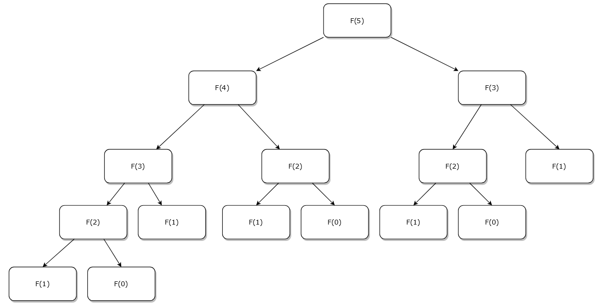

**Question 4 :** implémentez en Java un algorithme permettant de calculer la suite de Fibonacci en utilisant la Programmation Dynamique avec l'Approche Ascendante (Bottom Up).

> [!solution]- Solution
> ```java
> int bottomUpFibonacci(int n) {
> 	if(n <= 1) {
> 		return n;
> 	}
> 	
> 	int[] result = new int[n + 1];
> 	result[0] = 0;
> 	result[1] = 1;
> 	
> 	for(int i = 2; i <= n; i++) {
> 		result[i] = result[i - 1] + result[i - 2];
> 	}
> 	
> 	return result[n];
> }
> ```
>
> Pour l'approche bottom-up, on va réorganiser l'ordre dans lequel on résout les sous-problèmes. On va commencer par calculer les cas de base $F(0)$ et $F(1)$, et progressivement arriver vers la valeur de $n$ donnée en entrée. De cette façon, on ne recalculera jamais une valeur dans la séquence.
>
> 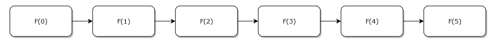

**Question 5 :** quelle est la complexité en temps et en espace de cette implémentation ? Est-il possible d'optimiser la complexité en espace, et si oui comment ?

> [!solution]- Solution
> **Complexité en temps :** $O(n)$, car il suffit d'itérer $n$ fois afin de réaliser le calcul de la séquence de Fibonacci.
>
> **Complexité en espace :** $O(n)$, car on utilise un tableau pour stocker $n + 1$ éléments.
>
> **Optimisation de la complexité en espace :** Afin de réaliser le calcul de la suite de Fibonacci, il suffit de conserver les 2 derniers résultats ($n - 1$ et $n - 2$). Donc, on peut retirer le tableau de taille $n + 1$ et le remplacer par seulement deux variables. La complexité en espace devient donc constante, $O(1)$.
>
> Implémentation optimisée :
> ```java
> int bottomUpFibonacci(int n) {
> 	if(n <= 1) {
> 		return n;
> 	}
> 	
> 	int previousResult = 0;
> 	int currentResult = 1;
> 	
> 	for(int i = 2; i <= n; i++) {
> 		int temp = previousResult + currentResult;
> 		previousResult = currentResult;
> 		currentResult = temp;
> 	}
> 	
> 	return currentResult;
> }
> ```

**Question 6 :** implémentez en Java un algorithme permettant de calculer la suite de Fibonacci en utilisant la Programmation Dynamique avec l'Approche Descendante (Top Down).

> [!solution]- Solution
> ```java
> int topDownFibonacci(int n, int[] tab) {
> 	// Base case
> 	if(n <= 1) {
> 		return n;
> 	}
> 	
> 	// Memoized case
> 	if(tab[n] != 0) {
> 		return tab[n];
> 	}
> 	
> 	// Add new entry in memoization table that has not been found yet
> 	tab[n] = topDownFibonacci(n - 1, tab) + topDownFibonacci(n - 2, tab);
> 	
> 	return tab[n];
> }
> ```
>
> Pour l'approche top-down, on stocke les valeurs déjà calculées dans un tableau (on suppose que ce tableau est initialisé hors de la méthode, avec $n + 1$ éléments contenant la valeur $0$, afin de pouvoir stocker la valeur pour l'index $n$). Lorsque le $n$ actuel que l'on veut calculer existe déjà dans le tableau, on renvoie simplement sa valeur. Sinon, on met à jour sa valeur dans le tableau (à l'index du $n$ actuel) pour ne plus devoir le recalculer plus tard.
>
> 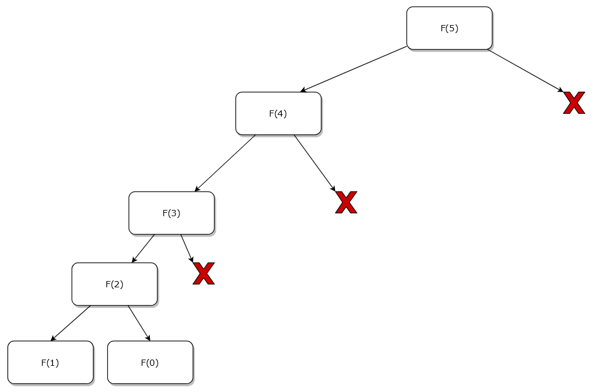

**Question 7 :** quelle est la complexité en temps et en espace de cette implémentation ?

> [!solution]- Solution
> **Complexité en temps :** $O(n)$, car dès qu'on a calculé la valeur pour un $n$ donné, on ne doit plus le recalculer (contrairement à l'approche naïve). Pour l'exemple avec $F(5)$, on ne calcule qu'une seule fois $F(2)$ au lieu de trois fois.
>
> **Complexité en espace :** $O(n)$, car on utilise un tableau pour stocker $n + 1$ éléments.

#### Exercice 6.2

**Monter un Escalier :** Gilles Doux doit monter $n$ marches d'un escalier. Gilles peut monter de 1, 2, ou bien 3 marches à la fois. Gilles aimerait bien connaître le nombre de façons dont il peut monter les marches. Par exemple, pour un escalier contenant 3 marches, il peut faire 1+1+1, 1+2, 2+1, et 3, ce qui correspond à 4 façons différentes de monter les marches. Implémentez un algorithme permettant de résoudre le problème d'ascension d'escalier, renvoyant le nombre de façons différentes de monter les marches (par 1, 2, ou 3 pas à la fois) d'un escalier de taille $n$. Utilisez la programmation dynamique.

> [!solution]- Solution
> ```java
> int climbStairs(int n, int[] memo) {
> 	// Base case
> 	if(n == 0) {
> 		return 1;
> 	}
> 	
> 	// Invalid case
> 	if(n < 0) {
> 		return 0;
> 	}
> 	
> 	// Memoization; memo array is initialized with -1 values
> 	if(memo[n] != -1) {
> 		return memo[n];
> 	}
> 	
> 	// Recursion
> 	memo[n] = climbStairs(n - 1, memo) + climbStairs(n - 2, memo) + climbStairs(n - 3, memo);
> 	
> 	return memo[n];
> }
> ```
>
> Problème similaire à la suite de Fibonacci (et à l'Exercice 1.11, où l'on ne montait que 1 ou 2 marches à la fois). Ici, on utilise la méthode top-down avec mémoïsation, comprenant 3 appels récursifs ($n - 1$, $n - 2$, et $n - 3$). Notre cas de base est `n == 0`, signifiant que s'il n'y a rien à escalader, on a une solution (càd, on a su décomposer $n$ en une possibilité valide). Si cependant `n < 0`, la décomposition n'est plus possible pour le $n$ donné et ne donne pas de solution.

#### Exercice 6.3

**Sous-séquence la Plus Longue :** soit une liste $l$, contenant des entiers. On vous demande de trouver la longueur de la sous-séquence la plus longue de $l$. Cela correspond à une séquence d'entiers, où chaque entier est supérieur au précédent, sans qu'ils soient nécessairement contigus. Par exemple, la sous-séquence la plus longue de la liste $[10, 9, 2, 5, 3, 7, 101, 18]$ est $[2, 3, 7, 18]$, ce qui correspond à une longueur de 4. Implémentez un algorithme permettant de résoudre le problème de la sous-séquence la plus longue. Utilisez la programmation dynamique.

> [!solution]- Solution
> ```java
> int longestIncreasingSubsequence(int[] tab) {
>
> 	int n = tab.length;
> 	int[] dp = new int[n];
> 	Arrays.fill(dp, 1); // So that every element in the array is a subsequence of length 1 by default
> 	
> 	for(int i = 1; i < n; i++) {
> 		// For each element tab[i], check all previous elements tab[j] with j < i
> 		for(int j = 0; j < i; j++) {
> 			// If tab[i] > tab[j], we can extend the subsequence ending at j by including tab[i]
> 			if(tab[i] > tab[j]) {
> 				// So, we update dp[i] with the maximum length possible (so far)
> 				dp[i] = Math.max(dp[i], dp[j] + 1);
> 			}
> 		}
> 	}
> 	
> 	// The maximum value in dp gives the length of the longest subsequence
> 	int max_length = 0;
> 	
> 	for(int length : dp) {
> 		max_length = Math.max(max_length, length);
> 	}
> 	
> 	return max_length;
> }
> ```
>
> L'invariant est que $dp[i]$ correspond à la plus longue sous-séquence se terminant par $tab[i]$. Par exemple, si l'on prend le tableau $tab$ qui vaut $[2, 8, 3, 5, 4, 1]$, son tableau $dp$ correspondant serait $[1, 2, 2, 3, 3, 1]$. On voit donc l'utilité de réitérer à la fin pour trouver la sous-séquence la plus longue, et pas uniquement prendre le dernier élément de $dp$ comme résultat.
> 
> On peut représenter cet invariant en JML comme `0 <= i < tab.length && dp[i] = 1 + \max(int j; 0 <= j < i && tab[j] < tab[i]; dp[j]);`
>
> **Complexité :**
> - $O(n^2)$ en temps, car on a deux boucles imbriquées qui itèrent sur les éléments du tableau
> - $O(n)$ en espace, car on utilise un tableau $dp$ pour stocker la longueur de la plus longue sous-séquence se terminant à chaque index

#### Exercice 6.4

**Le Voleur de Maisons :** un voleur se trouve dans un quartier contenant $n$ maisons, et compte voler leurs biens. Cependant, afin de ne pas alarmer la police, le voleur ne peut pas entrer dans 2 maisons adjacentes. Il aimerait donc savoir quelle est la somme maximale de biens qu'il peut récupérer, en tenant compte de cette contrainte. Par exemple, pour les maisons avec les biens $[6, 7, 1, 3, 8, 2, 4]$, la somme maximale des biens est 19 (il vole les maisons d'index 0, 2, 4, et 6, ce qui correspond à $6 + 1 + 8 + 4 = 19$). Implémentez un algorithme permettant de résoudre le problème du voleur de maisons, renvoyant la somme maximale des biens pour une liste de maisons $hlist$ donnée en entrée. Les numéros de maison sont les index de la liste, et les valeurs correspondent aux biens de chaque maison. Utilisez la programmation dynamique.

> [!solution]- Solution
> **Implémentation Top Down avec Mémoïsation :**
> ```java
> // Suppose that memo is initialized with -1 values (of size n + 1), and that n = hlist.length
> int maxStealTopDown(int[] hlist, int n, int[] memo) {
>
> 	// Base case 1: If no more houses
> 	if(n <= 0) {
> 		return 0;
> 	}
> 	
> 	// Base case 2: If list contains 1 element, return it
> 	if(n == 1) {
> 		return hlist[0];
> 	}
> 	
> 	// Memoization
> 	if(memo[n] != -1) {
> 		return memo[n];
> 	}
> 	
> 	// If stealing from current house, cannot steal the next house so n - 2 in recursion
> 	// hlist[n - 1] represents the last house we can steal from, given n
> 	int steal = hlist[n - 1] + maxStealTopDown(hlist, n - 2, memo);
> 	
> 	// If not stealing from current house, can steal house at n - 1
> 	int notSteal = maxStealTopDown(hlist, n - 1, memo);
> 	
> 	// The value of memo[n] is the max between stealing or not stealing
> 	memo[n] = Math.max(steal, notSteal);
> 	
> 	return memo[n];
> }
> ```
>
> Le choix se résume à 2 possibilités :
> - Voler la maison actuelle + voler les maisons avant celle d'avant
> - Voler la maison avant + tout ce qui a été volé avant
>
> **Complexité :**
> - $O(n)$ en temps
> - $O(n)$ en espace
>
> **Implémentation Bottom Up avec Tabulation :**
> ```java
> int maxStealBottomUp(int[] hlist) {
> 	int n = hlist.length;
> 	
> 	if(n == 0) {
> 		return 0;
> 	}
> 	if(n == 1) {
> 		return hlist[0];
> 	}
> 	
> 	// Only need to keep 2 last values instead of using a DP array (reduces space complexity)
> 	int lastBefore = 0;
> 	int lastNow = hlist[0];
> 	
> 	// Use bottom-up approach
> 	int result = 0;
> 	for(int i = 1; i < n; i++) {
> 		result = Math.max(hlist[i] + lastBefore, lastNow);
> 		lastBefore = lastNow;
> 		lastNow = result;
> 	}
> 	
> 	return result;
> }
> ```
>
> L'implémentation est optimale car le résultat ne dépend que des deux dernières valeurs (soit on vole la maison actuelle et celle deux maisons avant, soit on vole la maison avant). On n'oublie pas de bien mettre à jour `lastBefore` et `lastNow`.
>
> **Complexité :**
> - $O(n)$ en temps
> - $O(1)$ en espace

#### Exercice 6.5

**Organisation de Travaux :** soit un ensemble de travaux ayant une heure de début, une heure de fin, et un certain profit associé à la réalisation du travail. On aimerait trouver le profit maximum que l'on peut obtenir en réalisant des travaux qui n'ont pas d'overlap.

Pour ce faire, on donne en entrée un tableau à deux dimensions, trié par heure de début croissante, avec chaque sous-tableau contenant :
-  `jobs[i][0]` : L'heure de début du travail `i`.
- `jobs[i][1]` : L'heure de fin du travail `i`.
- `jobs[i][2]` : Le profit suite au travail `i`.

Implémentez un algorithme en Java permettant de résoudre ce problème, en utilisant la programmation dynamique. Lorsque vous devez trouver le prochain travail dont l'heure de début n'est pas en conflit avec l'heure de fin du travail actuel, implémentez une fonction employant la recherche binaire.

> [!solution]- Solution
> **Implémentation Top Down avec Mémoïsation :**
> ```java
> public class JobOrganizationTopDown {
>
> 	// Function works as a binary search for the next possible job
> 	static int findNextPossibleJob(int i, int[][] jobs) {
> 	
> 		int low = i + 1;
> 		int high = jobs.length - 1;
> 		
> 		while(low <= high) {
> 			int mid = (low + high) / 2;
> 			
> 			if(jobs[mid][0] >= jobs[i][1]) {
> 				high = mid - 1;
> 			}
> 			else {
> 				low = mid + 1;
> 			}
> 		}
> 		
> 		return low;
> 	}
>
> 	static int solve(int i, int[][] jobs, int[] dp) {
> 	
> 		// Base case
> 		if(i >= jobs.length) {
> 			return 0;
> 		}
> 		
> 		// Memoized case
> 		if(dp[i] != -1) {
> 			return dp[i];
> 		}
> 		
> 		// If we skip the current job
> 		int skip = solve(i + 1, jobs, dp);
> 		
> 		int nextJobIndex = findNextPossibleJob(i, jobs);
> 		// If we take the current job
> 		int take = jobs[i][2] + solve(nextJobIndex, jobs, dp); // jobs[i][2] gives us the profit for the job with index i
> 		
> 		// Store in dp[i] the best solution (skip or not)
> 		dp[i] = Math.max(take, skip);
> 		
> 		return dp[i];
> 	}
>
> 	public static void main(String[] args) {
> 		
> 		// Jobs are sorted by start time
> 		int[][] jobs = {
> 			{1, 5, 25},
> 			{2, 3, 20},
> 			{4, 7, 50},
> 			{4, 8, 40},
> 			{9, 12, 30}
> 		};
> 		
> 		int n = jobs.length;
> 		int[] dp = new int[n]; // The array that will be used for memoization
> 		Arrays.fill(dp, -1); // Fill the array with -1 to indicate no existing result because 0s can potentially be memoized results
> 		
> 		int result = solve(0, jobs, dp);
> 		System.out.println(result);
> 	}
> }
> ```
>
> - Complexité en temps : $O(n log n)$
> - Complexité en espace : $O(n)$
>
> **Implémentation Bottom Up avec Tabulation :**
> ```java
> public class JobOrganizationBottomUp {
>
> 	// Function works as a binary search for the next possible job
> 	static int findNextPossibleJob(int i, int[][] jobs) {
> 	
> 		int low = i + 1;
> 		int high = jobs.length - 1;
> 		int answer = jobs.length;
> 		
> 		while(low <= high) {
> 			int mid = (low + high) / 2;
> 			
> 			if(jobs[mid][0] >= jobs[i][1]) {
> 				answer = mid;
> 				high = mid - 1;
> 			}
> 			else {
> 				low = mid + 1;
> 			}
> 		}
> 		
> 		return answer;
> 	}
>
> 	static int solve(int[][] jobs) {
> 	
> 		int n = jobs.length;
> 		int[] dp = new int[n + 1]; // The array that will be used for tabulation
> 		
> 		// Iterate in reverse (we build the dp table from the end)
> 		for(int i = n - 1; i >= 0; i--) {
> 			int nextJobIndex = findNextPossibleJob(i, jobs);
> 			
> 			int take = jobs[i][2] + dp[nextJobIndex];
> 			int skip = dp[i + 1];
> 			dp[i] = Math.max(take, skip);
> 		}
> 		
> 		return dp[0];
> 	}
>
> 	public static void main(String[] args) {
> 		
> 		// Jobs are sorted by start time
> 		int[][] jobs = {
> 			{1, 5, 25},
> 			{2, 3, 20},
> 			{4, 7, 50},
> 			{4, 8, 40},
> 			{9, 12, 30}
> 		};
> 		
> 		int result = solve(jobs);
> 		System.out.println(result);
> 	}
> }
> ```
>
> - Complexité en temps : $O(n log n)$
> - Complexité en espace : $O(n)$

## Sources

**Chapitre 1 :**
- Image Graphe Complexité : https://devopedia.org/algorithmic-complexity
- Image Mémoïsation Fibonacci : https://www.linkedin.com/pulse/dynamic-programming-caching-memoization-example-why-hakeem-dahou

**Chapitre 4 :**
- Image Processus Diviser pour Régner : https://www.khanacademy.org/computing/computer-science/algorithms/merge-sort/a/divide-and-conquer-algorithms
- Image Merge Sort : https://en.wikipedia.org/wiki/Divide-and-conquer_algorithm
- Image Quick Sort : https://www.techiedelight.com/quicksort

**Chapitre 5 :**
- Image Exemple Monnaie Minimale : https://en.wikipedia.org/wiki/Greedy_algorithm