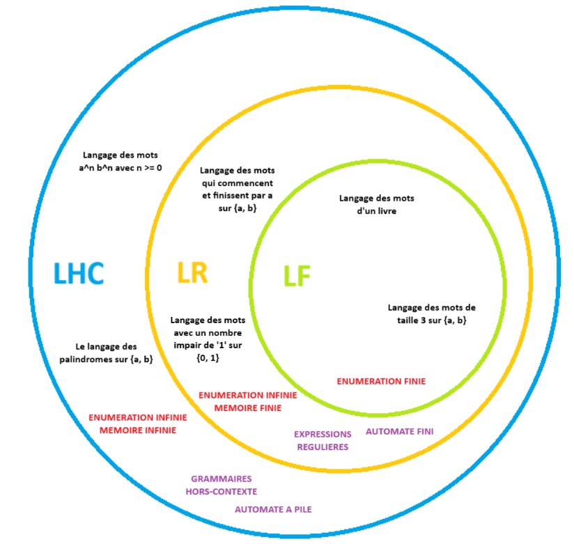
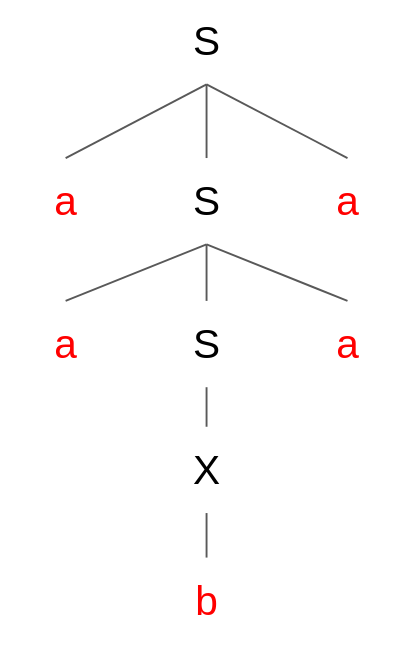

# Chapitre 2 - Langages Hors-Contexte

*Dernière mise à jour : 22/10/2026*

## Langages Hors-Contexte

Lors du chapitre précédent, nous avons vu les langages réguliers. Bien qu'intéressants, ces types de langage avaient une principale faiblesse : une mémoire finie. Par exemple, considérons l'alphabet $\{ a, b \}$ et le langage "les mots qui ont autant de $a$ que de $b$". Pour dire que ce langage est régulier, il faut pouvoir le représenter par une expression régulière (ou bien un automate fini). Cependant, on se rend vite compte qu'il est impossible de trouver une expression régulière pour ce langage :

- Si l'on utilise $(ab)*$, on obtient bien des mots avec autant de $a$ que de $b$. Cependant, les mots du genre $aabb$ ou $aabbba$ ne peuvent pas être générés, alors qu'ils contiennent bien autant de $a$ que de $b$.
- Si l'on utilise $(a|b)*$, on peut obtenir des mots qui n'ont pas autant de $a$ que de $b$.
- ...

En conséquence, on ne trouvera jamais une expression régulière permettant de représenter ce langage. Cependant, nous allons découvrir un nouveau type de langage qui permet de le représenter : les langages *hors-contexte*.

Un **langage hors-contexte** est un langage qui peut être représenté par une grammaire hors-contexte ou un automate à pile. Souvent, on prouve qu'un langage est hors-contexte en le représentant par une de ces deux formes-ci.

> Un langage hors-contexte n'est pas nécessairement un langage régulier. Ceci est dû au fait que les langages réguliers sont des sous-ensembles des langages hors-contexte, donc on peut très bien trouver un langage hors-contexte qui n'est pas régulier.

## Classification de Langages

Nous pouvons classifier les différents types de langages que nous avons vu :



La représentation peut se visualiser comme les couches d'un oignon, où chaque nouvelle couche apporte de la précision et de la restriction quant aux langages possibles à représenter. On voit visuellement que si un langage est fini, alors il est également régulier et hors-contexte. Si un langage n'est pas fini mais régulier, il reste hors-contexte.

## Grammaire Hors-Contexte

Une **grammaire hors-contexte** est un type de grammaire formelle permettant de décrire la syntaxe d'un langage. Une grammaire hors-contexte peut comprendre les éléments suivants :

- **Terminal** : élément/symbole qu'une grammaire hors-contexte peut générer. Un terminal est un élément le plus fondamental d'une grammaire hors-contexte, et est écrit en minuscules : $a$, $b$, $c$, $if$, $payment$, etc.
- **Non-Terminal** : élément intermédiaire d'une grammaire hors-contexte qui n'apparaît pas dans les phrases générées. Un non-terminal peut être interprété comme une référence vers une ou plusieurs productions (et de façon ultime vers des terminaux, si la grammaire est bien formée) possibles de la grammaire, et est écrit en majuscules (souvent, une seule lettre) : $S$, $X$, $A$, etc.
- **Symbole de Départ** : non-terminal servant de point d'entrée pour une grammaire hors-contexte. Souvent, il est représenté par $S$.
- **Production** : règle d'une grammaire hors-contexte qui indique comment un symbole non-terminal peut être remplacé par une suite d'autres symboles (terminaux et/ou non-terminaux). On représente une production par la forme $A \rightarrow b$, avec $A$ un symbole non-terminal et $b$ une suite de symboles (pouvant contenir des terminaux et des non terminaux, voire être vide).

Par exemple, prenons la grammaire hors-contexte $S \rightarrow a$. Cette grammaire indique que lorsqu'on va dans le non-terminal $S$, on doit appliquer l'unique production $\rightarrow a$, c'est-à-dire générer le terminal $a$. Vu que le non-terminal $S$ est le symbole de départ, on sait que c'est le point d'entrée dans notre grammaire. En conséquence, cette grammaire simple représente le langages du mot $a$.

Prenons un exemple un peu plus avancé :

```
S -> a | B
B -> b | c | ε
```

Dans cette grammaire hors-contexte, on retrouve le non-terminal de départ $S$ qui permet de produire soit un terminal $a$, soit un non-terminal $B$. Si l'on choisit de produire $B$, on doit aller voir ce qu'on peut générer dans les productions de $B$ : soit un terminal $b$, soit un terminal $c$, soit rien (représenté par un caractère epsilon $\varepsilon$). En conséquence, cette grammaire permet de générer les mots suivants : $\{ a, b, c, \varepsilon \}$.

Prenons un dernier exemple :

```
S -> aSa | X
X -> b | c
```

Cette grammaire hors-contexte représente le langage $L = \{a^nxa^n | x \in \{b, c\}, n \ge 0\}$. On remarque qu'il est possible d'utiliser le même non-terminal dans une production que celui qui le produit. Ce mécanisme de récursivité permet aux grammaires hors-contexte de générer des mots potentiellement infinis. On remarque également qu'on peut concaténer des terminaux et des non-terminaux tel que $aSa$. En faisant cela, l'élément entre les deux $a$ correspondra à une des productions de $S$.

## Dérivation et Arbre Syntaxique

**Dérivation** : en partant du non-terminal de départ d'une grammaire hors-contexte, montrer comment un mot peut être obtenu en suivant l'ensemble de règles définies par ce non-terminal. Si un mot peut être dérivé en suivant les règles d'une grammaire hors-contexte, alors ce mot peut être représenté par la grammaire hors-contexte.

Il est également possible de représenter une dérivation sous forme d'un **arbre syntaxique**. Si l'on reprend la grammaire précédente, nous pouvons représenter la dérivation du mot $aabaa$ sous forme d'un arbre syntaxique :



> S'il existe plusieurs dérivations possibles avec une grammaire hors-contexte pour un même mot, on dit que la grammaire hors-contexte est **ambiguë**.

## Improductif et Inaccessible

Il est possible qu'une grammaire hors-contexte soit malformée, menant à des problèmes de génération de mots et des problèmes de structure. Ces malformations peuvent être de deux types :

- **Improductif** : un non-terminal est dit *improductif* si aucune dérivation à partir de ce non-terminal ne permet de produire une chaîne composée uniquement de symboles terminaux.
- **Inaccessible** : un non-terminal est dit *inaccessible* s'il n'est jamais atteint à partir du symbole de départ $S$ lors d'une dérivation.

Par exemple, dans la grammaire hors-contexte suivante :

```
S -> A | B
A -> a | b
B -> Ba
C -> c | d
```

Le non-terminal $B$ est improductif (ne génère jamais une chaîne de terminaux) et le non-terminal $C$ est inaccessible (ne peut jamais être atteint en partant de $S$). En supprimant ces improductifs et inaccessibles, la grammaire devient :

```
S -> A
A -> a | b
```

Et encore plus simplement :

```
S -> a | b
```

> Si un non-terminal $X$ contient des productions $\alpha$, $\beta$, $\gamma$, et que la production $\beta$ contient un élément qui mène à un improductif, il suffit de supprimer la production $\beta$ du non-terminal. Les productions $\alpha$ et $\gamma$ sont elles préservées, tant qu'elles ne contiennent pas des improductifs.

## Automate à Pile

Un **automate à pile** est une machine abstraite comportant les éléments suivants :

- Un ensemble d'états.
- Un état initial.
- Un ensemble d'états terminaux.
- Un ruban, permettant de lire un mot donné. La fin de lecture est représentée par le caractère $\#$.
- Une tête de lecture (indique l'emplacement de lecture actuel).
- Une pile LIFO (Last In First Out), permettant d'empiler et de dépiler des états.
- Des règles de transition. $(I, a, F)$ = si l'état $I$ est en haut de la pile et que le token $a$ est rencontré en lecture du ruban, alors le token $a$ est lu et l'état $F$ va remplacer l'état $I$ dans la pile. Fonction de transition : on passe d'un état à un autre.

Les automates à pile sont des généralisations des automates finis, car un automate à pile dispose d'une mémoire infinie organisée en pile.

Un automate à pile est dit **déterministe** si :

- L'automate ne comprend pas des transitions $\varepsilon$ (ne rien lire et avancer "gratuitement"), c'est-à-dire pas de $(I, \varepsilon, F)$.
- L'automate ne permet pas la lecture du même symbole depuis un état vers des états différents, c'est-à-dire pas de $(I, a, E1)$ et $(I, a, E2)$, car $a$ pourrait prendre la transition vers l'état $E1$ ou $E2$.

## License

&copy; 2024-2026 Alix Decrop. Le contenu de cette page est mis à disposition selon les termes de la license [Creative Commons Attribution - CC BY-NC-ND 4.0](https://creativecommons.org/licenses/by-nc-nd/4.0/).